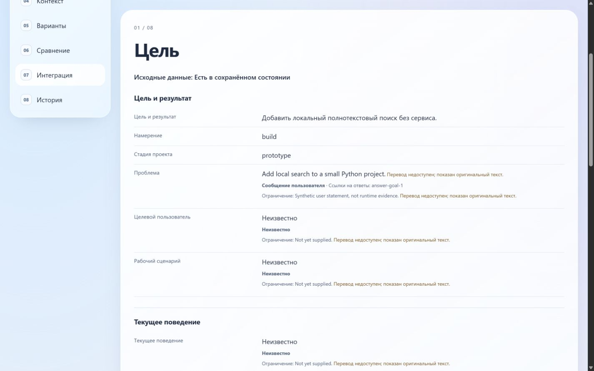
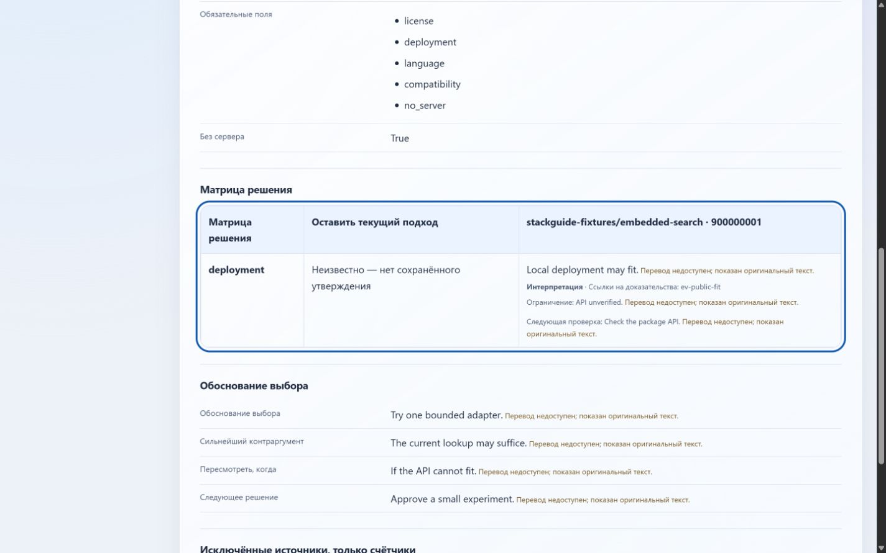

# CP-10 supported HTTP browser verification — 2026-10-17

Current task status: `completed_local_ui_owner_accepted` following explicit [owner acceptance](cp10-owner-acceptance-2026-10-17.json) on 2026-10-17. **CP-10 is closed with the disclosed unverified limits accepted by the owner.** Execution evidence remains partially verified; the [machine-readable observations](cp10-browser-http-2026-10-17.json) preserve original check outcomes and source bindings. CP-11 is next and has not started. CP-04 acceptance stays closed.

## Permission applied and access observed

The owner explicitly authorized the prepared rule for `http://127.0.0.1:8765`. It was appended to the user `config.toml` after successful normal approval review. Existing bytes remain an identical prefix, and parsed configuration equals the backup plus this one origin. Uploads, downloads and full CDP remain denied; persistent approval is disabled and the access approval lifetime is one turn. No other origin, project configuration or approval behavior changed. [Application receipt and backup location](cp10-loopback-8765-applied-2026-10-17.json).

The initial HTTP attempt reached connection refusal before a server existed. A sandboxed server then encountered a connection timeout; an independent local socket check returned `WinError10013`. The same bounded server was relaunched through successful normal escalation review and the Codex in-app browser rendered the page over HTTP. This is observed permitted access, not an attestation of the complete effective desktop policy or proof of which configuration layer allowed it. The earlier [file-protocol refusal](cp10-browser-acceptance-2026-10-17.md) and [inactive proposal](cp10-browser-policy-2026-10-17.md) remain historical records.

The temporary server bound only `127.0.0.1:8765` and served fixed synthetic HTML routes with GET/HEAD. It exposed no directory listing, state JSON, run JSON, credentials or repository root. All other routes were absent from its in-memory map. The owned server was stopped after the checks. The exact-origin configuration remains installed as requested; no extension or global network settings were weakened.

## Observed checks

| ID | Result | Current evidence and limit |
| --- | --- | --- |
| UI-01 | PASS, bounded | Eight views in RU and EN: 16 nonempty rendered panels with correct headings and no focus in hidden content. This is a synthetic source-bound UI review. |
| UI-02 | PASS | Populated comparison and integration at outer viewport widths 1280, 1440, 1920 and 1000, both locales: 16 settled combinations. Document width does not overflow; the 15px scrollbar difference is retained. Matrix is keyboard-focusable with a visible 3px outline. |
| UI-03 | PASS | Enter, Tab/Shift+Tab, skip link to main, Back/Forward between views and invalid fragment recovery to Goal/RU work. Focus does not remain in a hidden section. |
| UI-04 | NOT VERIFIED | `ctrl+plus` produced no observed zoom or viewport change. No browser zoom capability is exposed. Resizing or CSS transformation was not substituted for actual 200% zoom. |
| UI-05 | NOT VERIFIED | `ctrl+p` left the page unchanged; no observable print preview opened. No print/media-emulation capability is exposed. Static print CSS is not print evidence. |
| UI-06 | PARTIAL | Unchanged production HTML bytes with an additional response CSP `script-src 'none'`: all eight sections remain readable; language/copy buttons stay hidden; handoff text remains available. Browser JavaScript settings were still enabled, so the actual `<noscript>` notice under globally disabled JavaScript is unverified. |
| UI-07 | PASS with limit | Response `Permissions-Policy: clipboard-write=()` causes visible manual-copy feedback, exact handoff text selection and focus on its target. Normal copy shows `Copied.`; tool clipboard readback returned empty, so exact OS clipboard delivery is unverified. No copied handoff was executed. |
| UI-08 | PASS | Locale switching preserves 25 DOM IDs, two source URLs and canonical candidate IDs, roles, execution status, authority and run identities/revisions. Missing translations retain visible original-text notices. Localized status captions are excluded from machine-value equality. |
| UI-09 | PASS, bounded | Fourteen RU/EN panel observations cover saved start/no memo, partial scan/missing translation, unavailable immutable history details and read-only legacy state. The full fixture shows the validated immutable run and saved-versus-prior HTML revisions. Failed/superseded publication is covered by fresh local tests, not a newly joined lifecycle. |
| UI-10 | PASS, bounded | After stopping the server, all 16 view/locale pairs still work from the loaded document. Original state, HTML and immutable run hashes remain unchanged. CSP prevents connections/external assets. This is server-down operation, not a browser-global network-off test or external request trace. |

The full retained fixture has partial source-owned translation coverage. Explicit original-text notices are expected; no new translations, candidate selection or recommendation were synthesized by the browser. The additional populated comparison uses the existing contract-test pattern and is marked synthetic/proposed. No disclosure controls are present in these fixtures; none are claimed tested.

## Source and regression verification

- Recomputed the retained full preview through the current CP-07 adapter, including its one validated historical run. Exact equality: 123344 bytes, SHA256 `e92152682fd31afdac23b349196bd8b286fd15ef8b291fc9572e3185ed17e4b9`.
- Fresh `C:\Python314\python.exe -B -m unittest discover -s tests -p test_plugin_artifact.py -v`: **16/16 passed, exit0**, with process-local TEMP/TMP under `.codex-tmp/cp10-browser-2026-10-17/test-temp`. Includes failed and superseded publication, immutable/missing history, legacy read-only validation, hostile text, translation integrity, overflow preservation and actual isolated CLI publication.
- Initial default TEMP produced seven sandbox write errors. Workspace TEMP resolved those errors; one CLI test then exposed that default `python` was CPython3.13.5, rejected by the current explicit CPython3.14 preflight. Reusing installed `C:\Python314\python.exe` passed all16. No code, supported-runtime contract or ACL changed.
- Evidence assertions verify 16 initial view/language pairs, 16 layout combinations, 14 state panels, 16 server-down pairs, exact denied-copy selection, locale identity/authority parity and three unchanged original preview/state/history files. Final configuration matches its application hash and differs from the backup only by the authorized origin.

Temporary helper, fixture HTML and detailed synthetic observations are retained under `.codex-tmp/cp10-browser-2026-10-17/`; the durable JSON retains their exact hashes and minimized conclusions. Production source and canonical fixtures were not changed. No Git history, external publication, installation, scanner, credentials or recommendation execution was involved.

## Accepted limitations and next task

The UI observations left unverified by the technical run are actual 200% browser zoom, actual print preview and the no-script notice under a globally disabled JavaScript setting. The owner accepted these limitations when closing CP-10; no pass is claimed for them. Exact OS clipboard delivery and global-offline request tracing also remain explicitly unverified. The advertised browser capabilities are visibility and viewport; tab capabilities are page assets and WebMCP. They do not expose these missing controls, and documented zoom/print shortcuts did not activate them. Full CDP remains denied by the requested minimal permission.

The owner stated: "CP-10 можно считать закрытым. Обнови документацию. Что делаем дальше ?" This is acceptance of the disclosed evidence ceiling and closure of the CP-10 gate, not a new manual or automated browser run. No CP-10 work remains pending. CP-11 is next with its CP-04/CP-10 prerequisites satisfied; CP-15 independent human/product/UI/privacy and CP-16 release acceptance remain separate. The original JSON observation receipt is unchanged and still records browser_gate_passed=false for the technical run; the separate owner receipt records task closure. No further permission or browser change was made by this documentation update.
