**Я рекомендую развивать myAI-StackGuide в систему с четырьмя отдельными частями: обнаружение репозиториев, поддержание проверяемых данных, поисковые индексы и подбор решений под конкретный проект.** Такая архитектура позволит двигаться к 100 000+ репозиториев, сохраняя небольшой и понятный пользователю результат поиска.

Главный вывод исследования: **первое препятствие сейчас — организация хранения и обновления данных.** Векторный поиск поможет находить больше подходящих решений, но сам по себе не устранит ограничения текущего конвейера.

Я изучил [rag-architecture-atlas.html](C:/Users/user/Documents/Codex/2026-10-20/new-chat/outputs/rag-architecture-atlas.html): каталог 36 подходов, архитектурные рекомендации, обновление производных данных, оценку качества и выбранные примеры реализации. Дополнительно проверил текущие генераторы, discovery/refresh, plugin retrieval и актуальную документацию GitHub и поисковых компонентов. Ниже — проектное предложение; реализацию и действующие планы я не менял.

**Текущая архитектура уже содержит несколько правильных решений, которые стоит сохранить.**

Сейчас в основном manifest находятся **2 500 уникальных GitHub repository ID** и 126 узлов таксономии. При этом статусы распределены так: **485 `accepted`, 1 987 `candidate`, 25 `reference`, 3 `benchmark`**. Поэтому число записей и число принятых куратором решений уже сейчас имеют разный смысл.

Хорошая основа:

- Постоянный числовой `github_repository_id`, позволяющий переживать переименование и перенос репозитория.
- Происхождение фактов, ссылки на evidence и явные неизвестные значения.
- SQLite FTS5, BM25 и RRF для объединения поисковых выдач.
- Ограниченный evidence pack: весь каталог не передаётся модели.
- Разделение публичного каталога и приватного состояния пользовательской сессии.
- Единственный writer состояния и неизменяемая History.

Но есть конкретные ограничения роста.

| Ограничение | Что происходит сейчас | Что потребуется |
|---|---|---|
| Размер корпуса закреплён в коде | Builder и SQL-проверки ожидают ровно 2 500 записей | Контракт произвольного проверенного snapshot с count/hash/version |
| Получение карточек зависит от всего файла | Для evidence pack snapshot полностью хешируется и потоково разбирается | Чтение карточек по ID с проверкой их версии и digest |
| Ограничение размера snapshot | В `context_pack.py` установлен предел 32 MiB | Новое представление хранения, совместимое с большим корпусом |
| Refresh не является регулярной актуализацией | Уже собранные блоки переиспользуются; основной сценарий — заполнение пропусков | Планировщик проверок по срокам и типам данных |
| Прогресс сохраняется большим JSON | После отдельных запросов переписывается весь checkpoint | Транзакционная фиксация отдельных jobs и observations |
| После небольших пачек повторяется полный обход | Повторно проверяются и формируются отчёты по накопленным данным | Проверки изменившихся записей; полная проверка при выпуске snapshot |
| Каталог целиком встроен в HTML | Фильтрация создаёт строки всех подходящих записей | Постраничная выдача и отдельная загрузка подробностей |

Источники ключевых ограничений: [builder индекса](C:/Users/user/Desktop/project/github_research/agentic-engineering-catalog/scripts/build_plugin_search_index.py:130), [context_pack.py](C:/Users/user/Desktop/project/github_research/agentic-engineering-catalog/plugins/myai-stackguide/scripts/context_pack.py:22), [refresh pipeline](C:/Users/user/Desktop/project/github_research/agentic-engineering-catalog/scripts/catalog_refresh_pipeline.py:264), [enrich_catalog.py](C:/Users/user/Desktop/project/github_research/agentic-engineering-catalog/scripts/enrich_catalog.py:190), [HTML template](C:/Users/user/Desktop/project/github_research/agentic-engineering-catalog/templates/unified_catalog.html:147).

Обнаружились и небольшие по объёму кода, но существенные для масштаба проблемы: [discovery import](C:/Users/user/Desktop/project/github_research/agentic-engineering-catalog/scripts/import_catalog_discovery.py:55) повторно хеширует весь входной файл внутри цикла записей, а [gap-fill](C:/Users/user/Desktop/project/github_research/agentic-engineering-catalog/scripts/catalog_gap_fill.py:312) ищет позицию элемента в списке при сортировке всей очереди. Такие операции нужно исправить до увеличения корпуса.

Оценка размеров показывает, почему простое увеличение лимита не подходит:

| Артефакт | Сейчас, 2 500 репозиториев | При 100 000 с той же плотностью данных |
|---|---:|---:|
| Основной manifest | 29,46 MB | ≈1,18 GB |
| Подробные plugin cards | 13,94 MB | ≈558 MB |
| SQLite search index | 2,05 MB | ≈82 MB |
| Standalone catalog HTML | 3,93 MB | ≈157 MB |

Правый столбец — **линейная арифметическая оценка, а не нагрузочный тест**. Особенно показательно, что сам поисковый индекс сравнительно компактен, а подробные карточки и способ их доставки становятся значительно тяжелее.

Существующие измерения охватывают реальный корпус 2 500 и синтетический 10 000. Поддержка реальных 100 000 пока не доказана: [отчёт CP-11](C:/Users/user/Desktop/project/github_research/agentic-engineering-catalog/docs/reports/cp11-local-lifecycle-2026-10-17.md:47).

---

**Из atlas я бы взял следующую комбинацию методов.**

| Подход | Применение в myAI-StackGuide | Приоритет |
|---|---|---|
| **Sparse / Lexical retrieval** | Точные названия, package names, протоколы, технологии, идентификаторы | Сохранить как основу |
| **Hybrid retrieval** | Находить решения по смыслу, даже если описание использует другую терминологию | Основное улучшение поиска |
| **Reranking** | Точнее упорядочивать найденные варианты по задаче и ограничениям пользователя | После проверки полноты первичного поиска |
| **Parent–Child** | Искать конкретный раздел README, затем возвращать связанные условия установки или ограничения | Включить в работу с документацией |
| **Contextual Retrieval** | Добавлять к фрагменту название проекта, раздел, назначение и версию | Сначала из проверенных метаданных; генерацию оценивать отдельно |
| **Structured / SQL retrieval** | Фильтровать язык, deployment, лицензию, зависимости и доступность | Обязательный слой |
| **Temporal RAG** | Хранить изменения фактов и отвечать «что было известно на момент рекомендации» | Обязательный принцип данных |
| **Adaptive / Corrective retrieval** | Углублять поиск при нехватке доказательств и завершать его при достижении бюджета | Ограниченный управляемый процесс |
| **Web / Federated retrieval** | Дополнять локальный snapshot свежими публичными сведениями | Отдельный online-режим |
| **Code / Repository RAG** | Изучать реальные integration surfaces выбранных проектов | Для короткого списка после первоначального отбора |
| **GraphRAG / LightRAG / HippoRAG** | Исследовать связи экосистем, зависимости и альтернативы | Позже, под конкретные вопросы |

Из atlas особенно важны четыре инженерных правила:

1. **Hybrid должен выполнять два независимых поиска.** Если сначала получить dense top-k, а затем применить BM25 только к ним, пропущенные точные совпадения не вернутся. RRF объединяет ранги независимых выдач. Это соответствует [документации Qdrant](https://qdrant.tech/documentation/search/hybrid-queries/).
2. **Reranker не исправляет отсутствие нужного репозитория среди кандидатов.** Сначала оцениваем candidate recall, затем качество финального порядка.
3. **Сгенерированное пояснение — отдельное производное представление.** Цитата и фактическое утверждение должны вести к оригинальному источнику. Это существенно для [Contextual Retrieval](https://www.anthropic.com/engineering/contextual-retrieval).
4. **Изменение источника инвалидирует зависимые данные:** карточку, chunks, embeddings, summaries, поисковый кэш и иногда рекомендацию.

При этом cookbook atlas нельзя переносить целиком в промышленный путь. Например, пример Contextual Retrieval повторяет ingestion при вызове, а Parent–Child собирает родителей обходом списка chunks. Для нас эти операции должны выполняться заранее или через индексированные связи.

Self-RAG, RAFT, Search-R1, FiD, Atlas и Speculative RAG я бы пока отложил: текущая задача не требует собственного обучения reader или поисковой политики. Для GraphRAG также есть дополнительный фактор: проверенный README Microsoft сейчас отмечает преимущественно maintenance mode и потенциально дорогую индексацию. [Источник](https://github.com/microsoft/graphrag).

**Предлагаемая общая архитектура выглядит так.**

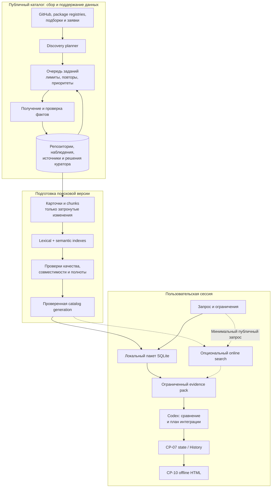

Здесь центральный каталог содержит публичные сведения. Приватный Brief, исходники проекта и история пользователя остаются в существующем контуре сессии. Online-поиск получает только разрешённое минимальное описание потребности.

Для хранилищ я предлагаю последовательный выбор:

| Вариант | Когда подходит | Решение |
|---|---|---|
| **SQLite для maintenance + SQLite FTS5 для чтения** | Один оператор, один host, контролируемые фоновые задания | Самый простой первый этап |
| **PostgreSQL + pgvector + PostgreSQL FTS** | Постоянный общий каталог, несколько workers, совместная курация, online-поиск | Предпочтительный следующий этап |
| **PostgreSQL + отдельный Qdrant** | Поиск требует самостоятельного масштабирования или возможностей, которых не хватает предыдущему варианту | Добавлять по результатам измерений |

Само число 100 000 не требует распределённой инфраструктуры. Сначала достаточно одного приложения с отдельными процессами планировщика, сбора и индексации и долговечной очередью в БД.

Для PostgreSQL важно учитывать, что его встроенный FTS использует `ts_rank`/`ts_rank_cd`, поэтому перенос с SQLite BM25 потребует отдельной оценки ранжирования. pgvector документирует hybrid с FTS и RRF, а также проблему недобора результатов после селективных фильтров в approximate search. [PostgreSQL FTS](https://www.postgresql.org/docs/current/textsearch-controls.html), [pgvector](https://github.com/pgvector/pgvector).

**Данные нужно хранить так, чтобы каждый факт можно было обновить и объяснить независимо.**

Минимальные сущности будущего maintenance store:

| Сущность | Что хранит |
|---|---|
| `repositories` | Постоянный GitHub ID, текущий canonical name, доступность |
| `aliases` | Историю имён и переносов |
| `discovery_occurrences` | Где, когда и по какому запросу нашли репозиторий |
| `observations` | Значение факта, источник, время проверки, статус, digest |
| `documents / chunks` | Версию README/документации, разделы, исходные координаты |
| `curation_decisions` | Решение, основания и версию политики |
| `jobs` | Тип работы, `due_at`, lease, попытки, ошибку и следующий запуск |
| `catalog_generations` | Состав опубликованной версии и точные compatibility pins |

Поле «последнее обновление» нужно разложить: время upstream-события, время нашей проверки, время изменения содержимого и время включения в поисковую версию. Если фактическое начало действия изменения неизвестно, его нельзя подменять временем обнаружения.

---

**Поиск я предлагаю строить в два уровня: сначала найти подходящие репозитории, затем собрать доказательства по короткому списку.**

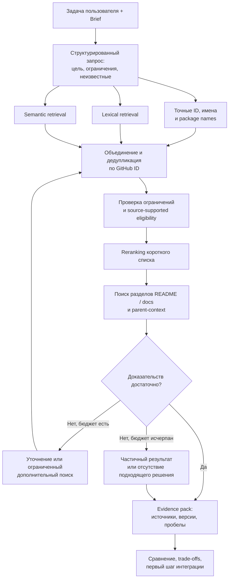

Например, пользователь ищет:

> «Локальный поиск по документам на русском, Python, без обязательного сервера, с permissive license».

В таком запросе:

- Exact/lexical ветвь сохраняет точность терминов и названий.
- Semantic ветвь находит проекты, описанные как *embedded retrieval*, *on-device search* или *offline document indexing*.
- Структурные проверки отделяют подтверждённую совместимость от неизвестной.
- Документация проверяет, действительно ли работа без сервера поддерживается.
- Итог объясняет применимость и ограничения, опираясь на конкретные источники.

Сейчас многие ограничения — лицензия, язык, deployment — проверяются **после** первичного lexical retrieval. При большом корпусе первые 150 результатов могут заполниться неподходящими проектами. Поэтому потребуется безопасный перенос части фильтров в retrieval и контролируемый дополнительный поиск при недоборе. При этом `unknown` нельзя автоматически трактовать как несовместимость: [matcher.py](C:/Users/user/Desktop/project/github_research/agentic-engineering-catalog/plugins/myai-stackguide/scripts/matcher.py:89).

Для документов предлагаю структуру:

`repository → document version → section → chunk`

В индексируемое представление фрагмента входят название проекта, путь документа, заголовок раздела и текст. Для цитирования сохраняются оригинальный текст, commit/content hash и положение фрагмента. Одинаковый текст из двух разных проектов не должен терять происхождение при дедупликации.

**Объём модельного контекста не должен расти вместе с каталогом.** Существующие пределы — до 12 карточек и 160 KiB evidence — полезно сохранить как исходную границу, отдельно проверив токеновый бюджет. Пересматривать их следует по качеству ответа, а не по числу записей в БД.

---

**Расширение до 100 000 должно быть непрерывным процессом с измерением покрытия.**

Предлагаемая цель — **100 000 уникальных релевантных репозиториев, доступных поиску и имеющих минимально проверенный набор фактов**. Отдельно считаются:

- обнаруженные репозитории;
- доступные поиску;
- имеющие достаточные доказательства для рекомендации;
- принятые куратором.

Это позволит автоматизировать масштабный сбор, сохранив смысл `accepted`.

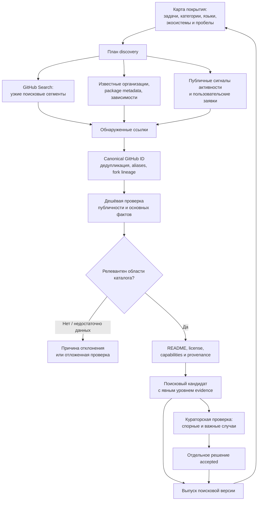

Источники discovery должны дополнять друг друга:

- **Таксономия и сценарии применения:** поисковые семейства по задачам, синонимам, технологиям и платформам.
- **Экосистемы:** организации, package metadata, публичные dependency declarations.
- **Связи:** интеграции, плагины, адаптеры и значимые самостоятельные forks.
- **Новые проекты и изменения:** временные окна поиска и публичные сигналы активности.
- **Пробелы поиска:** задачи, для которых каталог регулярно не находит подходящих вариантов. Для общей очереди используется только разрешённое обезличенное описание потребности.

Звёзды могут определять приоритет проверки, но жёсткий высокий порог отсечёт молодые и нишевые решения. Нужны отдельные выборки малоизвестных проектов и аудит распределения по категориям и языкам.

У GitHub Search есть важное ограничение: **до 1 000 результатов на поисковый запрос**. Поэтому планировщик должен разбивать широкие запросы, например по диапазонам `created`, языкам и другим поддерживаемым qualifiers. Переполненный или `incomplete_results=true` сегмент нельзя считать полностью обработанным. Нужны сохранённые параметры сегмента, checkpoint, повторные проходы с перекрытием и дедупликация по ID. [GitHub Search API](https://docs.github.com/en/rest/search/search).

Для широкого inventory существует и `List public repositories` с cursor `since`, но такой обход сам по себе не определяет полезность проекта и не заменяет актуализацию уже известных записей. [GitHub repositories API](https://docs.github.com/en/rest/repos/repos#list-public-repositories).

Для курации я бы применил **автоматическую проверку фактов + человеческую проверку значимых решений**. Машина может собирать метаданные, проверять identity, предлагать категории и искать противоречия. Принятие в `accepted`, спорные лицензии, существенные изменения назначения и неоднозначные классификации остаются отдельными решениями. Дополнительно нужна выборочная проверка обычных машинных результатов.

---

**Актуальность нужно поддерживать по группам данных и приоритетам использования.**

Для каждого задания определяются: репозиторий, группа фактов, срок проверки, причина приоритета, бюджет и состояние последней попытки.

Начальная политика может выглядеть так — это предложение для калибровки:

| Группа | Предлагаемая проверка |
|---|---|
| Часто рекомендуемые и активно используемые проекты | Основные факты ежедневно; критичные сведения перед новой рекомендацией |
| Остальной активный каталог | Еженедельно |
| Редко используемые стабильные проекты | Ежемесячно |
| Новый кандидат | Проверка при включении и ранняя повторная проверка |
| README, manifests, embeddings | При изменении соответствующего содержимого |
| Переименование, недоступность, изменение license | Приоритетная перепроверка и пересмотр eligibility |

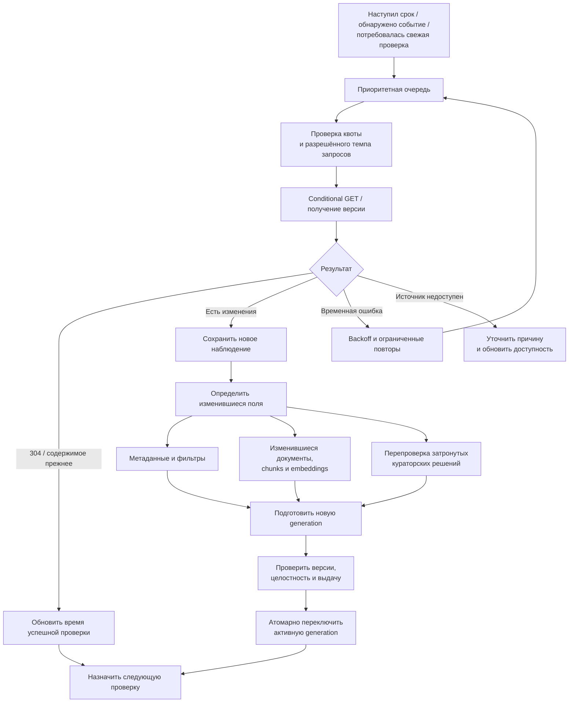

Изменение количества stars не должно запускать повторный embedding README. Изменение README не должно пересчитывать embeddings всех репозиториев. Изменение модели embeddings, напротив, создаёт отдельную версию всего соответствующего индекса.

Conditional requests с ETag помогут экономить передачу данных; корректно авторизованный ответ `304` не расходует primary REST quota. Однако сетевые обращения и другие ограничения остаются. Нужно учитывать `Retry-After`, rate-limit headers и ограничивать повторы. GitHub рекомендует очередь и последовательные запросы для снижения риска secondary limits. [GitHub REST best practices](https://docs.github.com/en/rest/using-the-rest-api/best-practices-for-using-the-rest-api).

**Собирать полный набор сведений обо всех репозиториях каждый день будет слишком дорого.** Текущий полный collector делает примерно 7–11 GET на репозиторий по успешной ветке. Для 100 000 это 700 000–1 100 000 запросов. При стандартной авторизованной квоте 5 000 запросов/час арифметический минимум составляет **140–220 часов**, ещё без повторов, secondary limits и остальных задач. [GitHub rate limits](https://docs.github.com/en/rest/using-the-rest-api/rate-limits-for-the-rest-api).

Для сравнения, сценарий:

- 5 000 репозиториев проверяются ежедневно;
- 25 000 — раз в неделю;
- 70 000 — раз в месяц;

даёт примерно **10 905 проверок в сутки при одной проверке на репозиторий**. Дополнительные запросы нужны только для обнаруженных изменений и нового enrichment. Это расчёт нагрузки, а не гарантированный SLA.

Webhooks полезны для репозиториев, где есть соответствующие права или установлен GitHub App. Подписаться таким способом на любые 100 000 чужих репозиториев нельзя. [Типы и права webhooks](https://docs.github.com/en/webhooks/types-of-webhooks). Public Events и [GH Archive](https://www.gharchive.org/) могут ускорять discovery, но остаются сигналами: Events API имеет ограниченную историю и задержки, поэтому периодическая сверка всё равно необходима. [GitHub Events API](https://docs.github.com/en/rest/activity/events).

При обновлении нужно также сохранить воспроизводимость: новый поиск использует одну согласованную generation; старая History продолжает ссылаться на свой snapshot. Свежие online-наблюдения отображаются как отдельное дополнение. Отзыв или блокировка источника должны учитываться и при rollback, чтобы возврат старой версии не возвращал запрещённую выдачу.

---

**Модернизацию я предлагаю выполнять последовательными этапами с проверяемым результатом каждого.**

| Этап | Изменения | Основной владелец | Условие завершения |
|---|---|---|---|
| **1. Определить контракт масштаба** | Что входит в 100 000; уровни evidence; политика свежести; offline/online scope | Product Planner + Catalog Architect | Согласованы счётчики, минимальная карточка и критерии включения |
| **2. Устранить линейную работу в каждом запросе** | Random-access card store; generic generation manifest; проверка целостности на границе открытия версии | Catalog Architect → Pipeline/Runtime Builder | Чтение evidence зависит преимущественно от выбранных карточек |
| **3. Сделать maintenance долговечным** | Jobs, observations, leases, retries, conditional requests; устранить повторные full-file операции | Pipeline Builder | Прерывание и повторный запуск не теряют прогресс и не дублируют результаты |
| **4. Вырастить реальный корпус до 10 000** | Discovery segments, provenance, разные классы проектов, контроль покрытия | Research Curator + Pipeline Builder | Известны стоимость сбора, качество данных и реальные узкие места |
| **5. Сравнить варианты поиска** | Lexical baseline, dense, hybrid, reranker, parent-context | Runtime Builder + Quality Evaluator | Улучшение подтверждено на одинаковых RU/EN запросах |
| **6. Проверить 50 000 и 100 000** | Нагрузка, обновления во время чтения, фильтры, объём пакета, recovery | Quality Evaluator | Пройдены согласованные performance и quality gates |
| **7. Включить регулярную эксплуатацию** | Расписание, наблюдаемость, журнал ошибок, выпуск generations и rollback | Назначенный operational owner | Есть ответственный, бюджет, правила остановки и восстановления |
| **8. Добавлять расширенные методы** | Online service, отдельный Qdrant, граф связей, глубокий Code RAG | По подтверждённому спросу | Есть измеримая польза относительно предыдущего этапа |

На этапе 2 полную проверку файлов нельзя просто убрать ради скорости. Нужен принятый контракт immutable generation: проверка при установке/открытии новой версии, точные hashes и проверка выбранных карточек. Кэш доверия не должен опираться только на путь и время изменения файла.

Полную сборку snapshot полезно сохранить как эталон воспроизводимости. При этом текущие 2 500 записей служат regression-набором: migration должна сохранять identity, provenance, принятую классификацию и читаемость старой History.

Для интерфейса нужны два разных результата: **браузер большого каталога с pagination** и существующий **небольшой offline HTML конкретной сессии**. Встраивать 100 000 подробных карточек в каждую пользовательскую страницу нецелесообразно.

**Поддержку 100 000 следует принимать по качеству и эксплуатации, а не только по числу загруженных строк.**

Я бы заложил следующие проверки:

- **Данные:** уникальные canonical IDs, источник каждого обязательного факта, корректные rename/fork relations и различимые `unknown`/`unavailable`.
- **Поиск:** Recall и nDCG по размеченным запросам; отдельно точные названия, RU/EN, перефразирование, редкие проекты и строгие ограничения.
- **Рекомендации:** поддержка утверждений источниками, корректный отказ и отсутствие подмены неизвестного свойства подтверждённым.
- **Нагрузка:** cold process startup → retrieval → card verification → evidence pack, вместе с памятью, размером и конкурентными обновлениями.
- **Жизненный цикл:** crash/restart, повтор job, повреждённая generation, rollback, недоступность источника и сохранность History.
- **Экономика:** запросы на новый пригодный репозиторий, стоимость поддержания 1 000 записей, backlog, доля просроченных проверок и объём повторной индексации.

Как первоначальные **предлагаемые**, ещё не принятые цели: exact-ID lookup — 100% на валидных ID; никаких нарушений жёстких ограничений в acceptance-наборе; candidate Recall@100 не ниже 0,95 на размеченном пуле; локальный путь до evidence pack — p95 до 1 секунды на выбранной контрольной машине. Окончательные пороги нужно закрепить после baseline и учитывать неполноту разметки.

Для оценки semantic-слоя считать надо количество фрагментов. Например, **100 000 репозиториев × 8 фрагментов × 1 024 компоненты × 4 байта ≈ 3,28 GB** только векторных значений. ANN, тексты, metadata и история требуют дополнительного места. Это объясняет пользу выборочного enrichment и индексации по изменениям.

**Первым практическим шагом я выбрал бы связку “maintenance store + очередь обновлений + random-access карточки”, сохранив FTS5 как baseline.** После этого — реальный корпус 10 000 и сравнительная оценка hybrid retrieval. Так каждый следующий уровень масштаба будет опираться на измерения, а обновление каталога станет частью архитектуры с самого начала.

В этой работе выполнены чтение кода и контрактов, подсчёт текущих данных, разбор atlas и проверка публичной документации. Нагрузочные тесты 100 000, запуск моделей и обновление метаданных каталога не проводились. Файлы репозитория не изменены; финальный Git status чистый.

<oai-mem-citation>
<citation_entries>
MEMORY.md:115-117|note=[Located existing retrieval, private state, and capacity evidence boundaries; checked against current repository]
</citation_entries>
<rollout_ids>
01a14b8d-cd65-7de1-ba60-23959631e2cd
</rollout_ids>
</oai-mem-citation>

---

Предыдущий ответ сохранён **полностью, без сокращений и переформулировок**: [stackguide-100k-architecture-answer-2026-10-20.ru.md](C:/Users/user/Desktop/project/github_research/agentic-engineering-catalog/research/stackguide-100k-architecture-answer-2026-10-20.ru.md). В файле 362 строки, включая четыре Mermaid-диаграммы и ссылки. Проверено побайтовое совпадение с исходным сообщением.

**Я поддерживаю развитие StackGuide как веб-продукта на Cloudflare.** Наиболее перспективная схема — общий обновляемый каталог и поиск на сервере, сайт для знакомства и работы с продуктом, локальный плагин для понимания конкретного проекта. Это даст удобный вход, общую инфраструктуру обновления и основу для монетизации. При этом главным преимуществом должен стать результат выбора и внедрения, который получает пользователь.

Изучение Context7 существенно уточняет нашу конкурентную позицию.

**Context7 уже значительно шире, чем инструмент получения документации по заранее известной библиотеке.**

Его Search API принимает вопрос, самостоятельно подбирает подходящие библиотеки и возвращает фрагменты документации со ссылками. Можно уточнять библиотеку, версию и язык. Поэтому утверждение «Context7 работает только после выбора библиотеки, а мы помогаем её найти» было бы слишком сильным: пересечение уже существует. [Context7 Search API](https://context7.com/docs/search-api)

Кроме того, на странице Docs7 компания заявляет **122 000 индексированных библиотек**. Это опубликованная метрика поставщика, которую я независимо не проверял; «библиотеки» также нельзя автоматически приравнять к уникальным GitHub-репозиториям. Однако для стратегии вывод очевиден: само достижение нами 100 000 записей не создаст заметного конкурентного преимущества. [Docs7](https://context7.com/docs7)

| Критерий | Context7 | myAI-StackGuide |
|---|---|---|
| Основная задача | Давать агенту документацию и примеры для выполнения задачи | Помогать выбрать OSS-решение под проект, сравнить варианты и подготовить внедрение |
| Поиск | Уже подбирает библиотеки и документацию по вопросу | Есть локальный поиск по структурированному каталогу; широкий серверный поиск предстоит развить |
| Понимание проекта | Получает запрос от агента; сам агент может учитывать проект | Есть собственный путь scanner → Project Context Brief → ограничения → подбор |
| Результат для пользователя | Релевантные фрагменты документации и кода | Целевой результат — обоснованный выбор, альтернативы, ограничения и план интеграции |
| Актуальность | Описаны автоматическое и ручное обновление источников | Текущий каталог основан на зафиксированном снимке; постоянное обновление нужно построить |
| Доставка | Сайт, API, MCP, CLI, SDK и интеграции с агентами | Развивается локальный плагин; веб-сервис и удалённый API ещё предстоят |
| Коммерческая зрелость | Публичные тарифы, private sources, командные и Enterprise-возможности | Монетизация и hosted-эксплуатация ещё не подтверждены |

Возможности Context7 подтверждаются его [официальным репозиторием](https://github.com/upstash/context7), [описанием обновлений](https://context7.com/docs/library-updates) и [тарифами](https://context7.com/plans). Наше позиционирование описано в [README](C:/Users/user/Desktop/project/github_research/agentic-engineering-catalog/README.md:3), а актуальная степень готовности — в [PLAN](C:/Users/user/Desktop/project/github_research/agentic-engineering-catalog/PLAN.md:9).

**Наше наиболее сильное направление — сопровождение технического решения с учётом проекта.** Здесь я вижу четыре потенциальных преимущества.

1. **Понимание исходной ситуации.** Пользователь спрашивает: «Как добавить поиск по документам в мой продукт?» StackGuide должен учитывать уже используемые БД, язык, инфраструктуру, ограничения команды и существующий код. Иногда полезный ответ — использовать возможности уже установленной системы.

2. **Сравнение альтернатив по существенным ограничениям.** Например: требования к инфраструктуре, сложность эксплуатации, поддерживаемые сценарии, ограничения лицензии, зрелость нужной функции, объём интеграции. Каждое существенное утверждение должно иметь источник или явно обозначенный пробел в доказательствах.

3. **Переход от рекомендации к проверяемому внедрению.** Какие компоненты затронуть, какой минимальный эксперимент провести, что считать успехом, когда отказаться от варианта. Здесь ценность измеряется временем до работающей интеграции.

4. **Пересмотр решения после изменений.** Пользователь выбрал решение несколько месяцев назад. Изменились требования проекта, версия библиотеки или её возможности. StackGuide может объяснить, какие основания выбора сохранились, а какие требуют повторной проверки.

Уже существующие scanner, Brief, evidence pack и история решений дают нам основу для этого направления. Но **превосходство над Context7 по качеству рекомендаций пока не доказано**.

Есть и существенные недостатки:

- В текущем каталоге 2 500 записей, из них 485 имеют статус `accepted`, 1 987 — `candidate`; это разные уровни проверки.
- В manifest сейчас только **10 stack recipes и 10 compatibility edges**. Для заявления о глубокой экспертизе по совместимости этого мало.
- Выбор архитектуры требует больше контекста и дороже проверяется, чем извлечение подходящего примера API.
- Польза Context7 объясняется одной короткой фразой. Наш продукт сложнее: его ценность нужно показывать на конкретном сценарии.
- Наша общая продуктовая и релизная приёмка остаётся открытой. Локальные проверки компонентов не подтверждают готовность SaaS.

Числа и ограничения отражены в [текущем описании каталога](C:/Users/user/Desktop/project/github_research/agentic-engineering-catalog/README.md:124) и [актуальном плане](C:/Users/user/Desktop/project/github_research/agentic-engineering-catalog/PLAN.md:9).

Я бы сформулировал обещание продукта так:

> **myAI-StackGuide помогает выбрать open-source решения под ваш проект, проверить основания выбора и превратить их в план внедрения.**

Для первого платящего сегмента я бы выбрал небольшие инженерные команды и технических основателей, которые регулярно добавляют возможности в существующий продукт. Их текущая альтернатива — самостоятельное исследование GitHub, документации и обсуждений вместе с обычным AI-ассистентом. Нам нужно доказать экономию времени именно относительно этого процесса.

Context7 при этом может быть полезным дополнительным источником на этапе реализации:

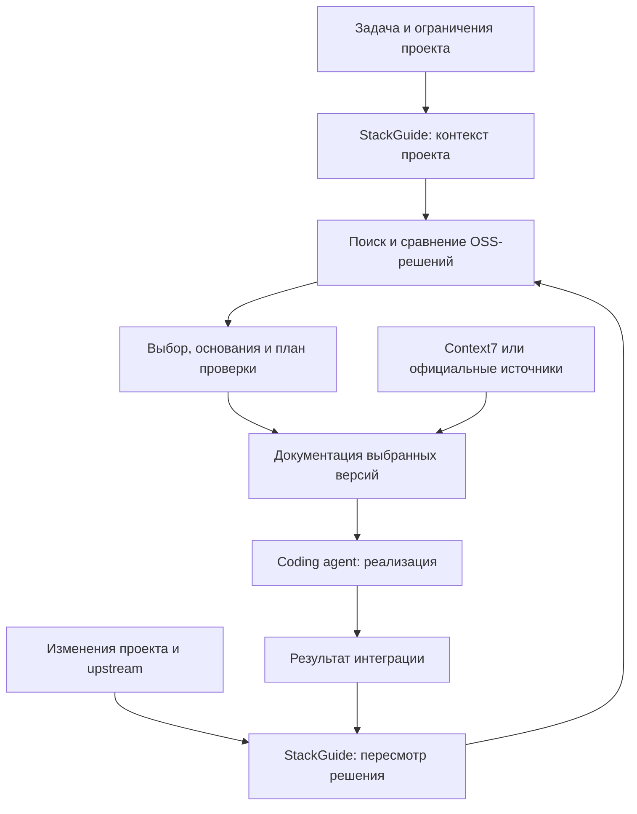

Это предлагаемая схема взаимодействия. Интеграция с Context7 была бы опциональной; её качество, условия использования и стоимость нужно оценить отдельно.

**Для веб-продукта я бы разделил три уровня развития — они сильно различаются по сложности.**

| Вариант | Что получает пользователь | Как меняется наша задача |
|---|---|---|
| Публичный сайт каталога | Поиск, категории, карточки, сравнения, ссылки для обмена | Умеренное расширение: веб-интерфейс, публикация, аналитика, SEO |
| Сайт с общей обновляемой базой | Свежие данные, серверный поиск, watchlists, история изменений | Появляются очереди, расписания, API, мониторинг, контроль расходов |
| Полный облачный помощник по приватному проекту | Загрузка контекста, персональные рекомендации и совместная работа | Добавляются хранение приватных данных, изоляция пользователей, права доступа, удаление данных, серверные модели и биллинг |

**Я рекомендую второй вариант с сохранением локального плагина.** Он создаёт общую базу знаний и публичный продукт, позволяя использовать уже проделанную работу с локальным контекстом.

Пользователю сайта достаточно описать общую задачу, чтобы исследовать варианты. Для глубокого анализа собственного кода он использует плагин. Плагин получает ограниченные карточки и evidence packs из общего каталога; состав отправляемого поискового запроса должен быть явно определён. Даже короткий запрос способен раскрыть чувствительные особенности проекта.

Серверный каталог упростит несколько вещей:

- Репозиторий собирается и обрабатывается централизованно, а результат используется всеми клиентами.
- Обновление данных перестаёт зависеть от скачивания пользователем новой версии каталога.
- Можно выдавать небольшую подборку вместо передачи всего корпуса.
- Исправления, новые источники и изменения классификации становятся доступны через общий API.
- У продукта появляются постоянные страницы, которыми удобно делиться и на которые можно ссылаться.

Одновременно мы принимаем ответственность за доступность, восстановление после сбоев, злоупотребления API, стоимость запросов и поддержку пользователей.

Есть ещё важный сдвиг: **в локальном варианте ответы составляет Codex, а полноценному веб-помощнику потребуется собственное подключение моделей и экономика их использования.** Обычный поиск и просмотр карточек можно запустить без генерации ответа на каждый запрос. Это разумно для первого веб-релиза.

**Cloudflare технически подходит для такого перехода, но перенос требует изменения структуры обработки.**

Предлагаемая архитектура:

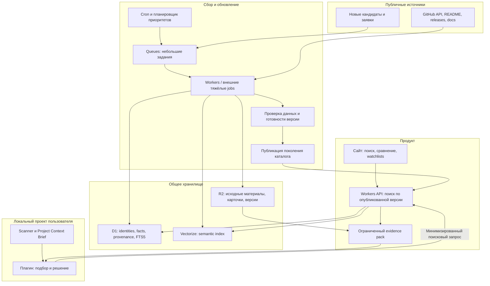

Здесь роли компонентов достаточно просты:

| Компонент | Роль |
|---|---|
| **Workers** | Сайт/API, обработка небольших заданий, объединение результатов поиска |
| **D1** | Структурированные факты, идентичности репозиториев, provenance, задания, полнотекстовый поиск |
| **R2** | Исходные материалы, карточки, выгрузки и версии каталога |
| **Vectorize** | Семантический поиск по фрагментам |
| **Queues** | Управление потоком заданий, повторы и обработка ошибок |
| **Cron / Workflows** | Запуск обновлений и восстановимая многошаговая обработка |

D1 официально поддерживает FTS5. Поэтому можно сохранить знакомый lexical baseline и отдельно проверить пользу Vectorize. Hybrid retrieval в этом варианте означает объединение независимых результатов FTS5 и vector search с последующей проверкой ограничений. [D1 SQL support](https://developers.cloudflare.com/d1/sql-api/sql-statements/), [Vectorize API](https://developers.cloudflare.com/vectorize/reference/client-api/)

У Cloudflare также есть managed **AI Search** с готовым hybrid search и RRF. Его стоит сравнить с собственным pipeline на пилоте: он может уменьшить объём разработки, если позволит сохранить наши требования к provenance, версиям и пригодности доказательств. [AI Search hybrid search](https://developers.cloudflare.com/ai-search/configuration/indexing/hybrid-search/)

Три ограничения важны для выбора архитектуры:

- **D1:** до 10 GB на одну платную БД; отдельная БД обрабатывает запросы последовательно. Небольшие карточки 100 000 репозиториев и миллион полнотекстовых фрагментов с историей — совершенно разная нагрузка. Нужно измерить размер индексов и конкуренцию запросов. [D1 limits](https://developers.cloudflare.com/d1/platform/limits/)
- **Workers:** 128 MB памяти на isolate. Текущие Python-процессы с загрузкой больших manifest и массовой обработкой нельзя считать готовыми к прямому переносу. Их нужно разделить на ограниченные задания либо выполнять тяжёлые части внешними workers. [Workers limits](https://developers.cloudflare.com/workers/platform/limits/)
- **Vectorize:** текущий лимит — до 20 млн векторов на индекс. Это позволяет рассматривать наш масштаб, но ничего не доказывает о качестве поиска или задержках на наших данных. [Vectorize limits](https://developers.cloudflare.com/vectorize/platform/limits/)

Если пилот покажет, что D1 или поисковые ограничения мешают, сайт и API можно оставить на Cloudflare, а хранилище/поиск вынести в PostgreSQL или специализированную систему. Hyperdrive помогает подключаться к внешней БД, но сам PostgreSQL не размещает. [Hyperdrive](https://developers.cloudflare.com/hyperdrive/get-started/)

**Самая важная часть серверной архитектуры — корректное обновление каталога.**

Я предлагаю такой процесс:

1. Планировщик выбирает репозитории по спросу, возрасту проверки, обнаруженным изменениям и важности для пользовательских watchlists.
2. Сборщик проверяет изменения upstream и сохраняет новую наблюдаемую версию.
3. Hash-сравнение определяет, какие документы и фрагменты действительно изменились.
4. Повторная классификация, извлечение фактов и embeddings выполняются только там, где изменились соответствующие входы.
5. Проверки подтверждают согласованность карточек, ссылок на источники и поискового индекса.
6. Новая версия становится доступной запросам; история предыдущих решений сохраняет использованные версии доказательств.
7. Для затронутых watchlists формируется объяснение существенных изменений.

У Context7 полезно взять **обновление по спросу**: запрос к устаревшей библиотеке запускает фоновую актуализацию, а текущий ответ использует уже имеющиеся данные. Для StackGuide я бы совместил этот подход с расписанием для отслеживаемых решений. Нужно показывать дату проверки, поскольку фоновое обновление не делает текущий ответ мгновенно свежим. [Keeping Libraries Fresh](https://context7.com/docs/library-updates)

В Enterprise on-premise Context7 также описаны сравнение commit, повторное использование extraction cache и обработка только изменившихся файлов. Эти механизмы хорошо соответствуют предложенной ранее модернизации нашего pipeline. [Automatic Repository Updates](https://context7.com/docs/enterprise/automatic-repository-updates)

Технически Queues допускает повторную доставку, а Vectorize применяет изменения асинхронно. Поэтому нужны идемпотентные задания, очередь окончательных ошибок и проверка готовности перед публикацией. D1, R2 и Vectorize не образуют общую транзакцию: запрос должен работать с одной опубликованной версией данных. [Queues delivery guarantees](https://developers.cloudflare.com/queues/reference/delivery-guarantees/), [Vectorize API](https://developers.cloudflare.com/vectorize/reference/client-api/)

**Для имиджа сайт даст больше возможностей показать ценность продукта.** На нём можно продемонстрировать законченный сценарий за несколько минут:

> «Вот задача и ограничения. Вот три подходящих варианта. Вот основания выбора, неизвестные факты и первый шаг проверки».

Я бы строил публичную часть вокруг:

- качественных страниц репозиториев с источниками и датами проверки;
- сравнений для конкретных задач;
- примеров законченных решений и интеграционных планов;
- понятной методологии оценки и механизма исправления ошибок;
- страниц категорий, которые объясняют различия между типами решений.

100 000 одинаковых страниц с пересказом README дадут слабый повод возвращаться. Репутацию создадут точность, полезные сравнения и честное отображение неизвестного.

У Context7 есть интересный пример развития в этом направлении: Docs7 объединяет размещение документации, аналитику вопросов агентов и подготовку недостающих материалов. Для нас полезна сама обратная связь: **неудачный поиск должен становиться сигналом, какой информации не хватает в каталоге**. [Docs7](https://context7.com/docs7)

**Монетизацию я бы строил вокруг сохранённых решений и их сопровождения.**

| Уровень | Предлагаемая ценность |
|---|---|
| **Free** | Публичный каталог, базовый поиск, источники, ограниченные сравнения |
| **Pro** | Сохранённые проекты и решения, углублённые исследования, watchlists, объяснение значимых изменений |
| **Team** | Общие решения команды, согласованный стек, внутренние ограничения, обсуждение и история пересмотра |
| **API / MCP** | Доступ агентов и других продуктов к структурированному поиску и evidence packs с квотами |

Главный коммерческий риск — **эпизодичность выбора технологий**. Пользователь может выбрать библиотеку и несколько месяцев не возвращаться. Для подписки нужен повторяющийся результат: поддержание принятого решения, исследование новых задач, пересмотр ограничений, командная работа.

Поэтому метрика «число найденных репозиториев» слабая. Более полезны:

- время до обоснованного shortlist;
- доля рекомендаций, дошедших до проверочного внедрения;
- доля успешных проверочных внедрений;
- полезность уведомлений об изменениях;
- возвращаемость команд к сохранённым решениям.

Для ориентира: на проверенной странице Context7 Pro указан **$10 за пользователя в месяц**, 2 000 включённых API-вызовов и $5 за следующие 1 000; обработка private repositories оплачивается отдельно. Это показывает формат монетизации, но не определяет цену StackGuide. [Context7 pricing](https://context7.com/plans)

Нашу цену следует проверять на платном пилоте. Для нерегулярных пользователей также имеет смысл разовая оплата глубокого исследования. Продажу мест в рекомендациях я бы исключил из основной модели: доверие к выбору — центральная ценность продукта.

Стоимость эксплуатации нужно считать по фактической работе:

> хранение + сбор изменений + извлечение фактов + embeddings + поиск + генерация ответов + наблюдаемость и поддержка.

Например, 100 000 репозиториев по восемь фрагментов — 800 000 фрагментов. Если за день меняются 2% репозиториев и у каждого требуется обработать все восемь фрагментов, это 16 000 фрагментов в день. Это **иллюстрация**, а не прогноз; сравнение content hashes должно заметно сокращать повторную обработку. Без выбранных моделей и измеренного поведения пользователей достоверной месячной сметы пока нет.

**Практическую последовательность я предлагаю такую:**

| Этап | Что сделать | Основание для перехода дальше |
|---|---|---|
| **1. Публичный продукт** | Сайт с текущим каталогом, понятным статусом данных, поиском и несколькими сильными сценариями сравнения | Пользователи понимают ценность и получают полезный результат |
| **2. Постоянное обновление** | Registry, задания, hashes, provenance, версии и публикация; пилот на выбранной области | Измерены свежесть, ошибки, стоимость и восстановление |
| **3. Серверный поиск** | FTS5 baseline, затем сравнительная проверка hybrid retrieval на реальном расширенном корпусе | Улучшение релевантности оправдывает стоимость и сложность |
| **4. Повторяющаяся платная ценность** | Сохранённые решения, watchlists, история изменений, командный пилот | Есть использование после первого выбора и готовность платить |
| **5. Масштаб 100 000+** | Расширение discovery и обработки с разной глубиной проверки | Рост корпуса сохраняет качество, свежесть и экономику |

Первые этапы стоит проектировать с поддержкой 100 000+, но выпуск полезного сайта не должен ждать заполнения всего корпуса. Я бы начал с **сайта, общего обновляемого каталога и локального плагина**, а первый платный сценарий связал с выбором и последующим сопровождением OSS-решения для существующего проекта.

В этой работе создан только Markdown-экспорт предыдущего ответа. Сравнение опирается на текущие файлы проекта и публичную документацию Context7/Cloudflare, проверенную 20 октября 2026 года. Сравнительный прогон рекомендаций, нагрузочный тест на 100 000 репозиториев и развёртывание сервиса не выполнялись; преимущества будущего продукта выше обозначены как предложения, требующие проверки.

<oai-mem-citation>
<citation_entries>
MEMORY.md:115-117|note=[Used prior local state and evidence boundaries as orientation; verified current readiness against PLAN]
</citation_entries>
<rollout_ids>
01a14b8d-cd65-7de1-ba60-23959631e2cd
</rollout_ids>
</oai-mem-citation>

---

Предыдущий ответ **полностью добавлен в тот же файл**: [stackguide-100k-architecture-answer-2026-10-20.ru.md](C:/Users/user/Desktop/project/github_research/agentic-engineering-catalog/research/stackguide-100k-architecture-answer-2026-10-20.ru.md). Первый ответ сохранён без изменений, второй добавлен дословно; теперь в файле **629 строк**. Проверено побайтовое совпадение добавленного текста с сообщением.

**Предложенная тобой связка «локальный scanner + skill → API/MCP → общий веб-сервис» выглядит наиболее подходящей архитектурой для StackGuide.** Jev хорошо вписывается в неё как кандидат на массовую классификацию публичных материалов. BGE-M3 выполняет другую работу — поиск по смыслу, а reranker уточняет порядок уже найденных результатов.

Я бы разделил систему на два процесса:

- **Подготовка знаний:** сервер собирает, классифицирует, проверяет и индексирует публичные репозитории.
- **Помощь пользователю:** локальный агент понимает проект, запрашивает ограниченную подборку доказательств и составляет рекомендацию с учётом полного контекста.

Это позволяет обрабатывать информацию о репозитории один раз и использовать результат во многих пользовательских сессиях.

**По моделям есть несколько важных уточнений из документации.**

| Модель | Подтверждённая роль | Предлагаемое применение у нас | Ограничение |
|---|---|---|---|
| `typesafe/jev` | Типизированные решения через `Noul`, `Choice`, `Score` | Категории, тип проекта, признаки возможностей, маршрутизация дальнейшей проверки | Уверенность модели нужно проверять на нашем корпусе |
| `@cf/baai/bge-m3` | Text embeddings, multilingual retrieval | Векторизация карточек, фрагментов документации и поисковых запросов | Hosted API требует отдельной проверки контракта |
| `@cf/baai/bge-reranker-base` | Оценка релевантности пары «запрос — фрагмент» | Перестановка ограниченного списка результатов после поиска | Upstream заявляет английский и китайский; русский требует проверки |
| Модель coding agent пользователя | Понимание проекта, объяснение и планирование | Итоговый выбор, сравнение, интеграционный план | Качество зависит от контекста и полученных доказательств |

Для Jev Cloudflare указывает контекст 32 000 токенов и цену **$0,042 за миллион входных токенов**, с бесплатным выходом. Модель помечена как **third-party**. В отличие от Cloudflare-hosted BGE, такой маршрут предполагает внешнего поставщика через инфраструктуру Cloudflare; наличие модели в dashboard не означает, что она исполняется на собственных GPU Cloudflare. [Jev в Cloudflare](https://developers.cloudflare.com/ai/models/typesafe/jev/), [Cloudflare AI](https://developers.cloudflare.com/ai/)

Ссылку на страницу твоего аккаунта через публичный web-инструмент открыть не удалось. Возможности модели я проверил по соответствующей публичной карточке и документации TypeSafe; доступность и квоты именно в аккаунте пока не проверены.

**Jev я бы использовал как недорогой механизм принятия узких структурированных решений.**

Например, после получения README и метаданных нам нужно ответить:

| Вопрос | Подходящий формат | Как использовать результат |
|---|---|---|
| Что это: библиотека, приложение, framework, пример, benchmark? | `Choice` | Записать предложенный тип объекта |
| Какие категории каталога подходят? | `Choice` и отдельные проверки дополнительных категорий | Создать машинную классификацию |
| Есть ли в данном фрагменте описание локального запуска? | `Noul` | Найти материалы для дальнейшего извлечения фактов |
| Документирована ли нужная возможность? | `Choice`: подтверждена / опровергнута / неизвестно | Сохранить различие между отсутствием функции и отсутствием доказательства |
| Насколько подробно описана установка? | `Score` с конкретной рубрикой | Определить потребность в дополнительном исследовании |

TypeSafe рекомендует задавать атомарные вопросы. Несколько независимых вопросов можно передать вместе: они оцениваются относительно одного `state`. Зависимые решения, например выбор дочерней категории после определения родительской, требуют отдельной логики. [TypeSafe introduction](https://docs.typesafe.ai/introduction)

Здесь важно различать три результата:

- **Классификация:** «репозиторий, вероятно, относится к orchestration».
- **Наблюдаемый факт:** «в документации такой-то версии есть этот способ запуска».
- **Рекомендация:** «данное решение подходит этому проекту при этих ограничениях».

Jev может помогать с первым и с проверкой отдельных утверждений второго уровня. Полноценная рекомендация складывается из нескольких источников, ограничений проекта и инженерного анализа.

Также Jev не должен определять GitHub ID, число stars, дату release или точный SPDX identifier по догадке. Эти данные собираются из соответствующих источников. Команды установки и ссылки на доказательства нужно извлекать и проверять отдельно.

**Особенно важно правильно понимать `confidence`.** У `Choice` и `Score` это величина, вычисленная из распределения вероятностей. Значение `0.95` само по себе не доказывает 95% точности на наших репозиториях. У `Noul` отдельного `confidence` нет: возвращается вероятность ответа «да». Пороги автоматической обработки следует выбирать по ошибкам на размеченных примерах. [TypeSafe Confidence](https://docs.typesafe.ai/confidence), [Noul](https://docs.typesafe.ai/primitives/noul)

Для нашей таксономии я бы сравнил два подхода:

1. Выбор основной категории из полного списка допустимых leaf-категорий.
2. Иерархический проход с сохранением нескольких вероятных веток.

Документация `Choice` допускает до 255 вариантов и описывает иерархическую классификацию с несколькими кандидатными путями. Наш текущий список из 111 тематических листьев позволяет проверить оба варианта. При этом дополнительные категории лучше оценивать отдельно: один репозиторий может выполнять несколько ролей. [TypeSafe Choice](https://docs.typesafe.ai/primitives/choice)

Неопределённая классификация должна оставлять репозиторий доступным для общего поиска. Ошибка классификатора не должна делать полезный проект невидимым.

**Серверный pipeline я предлагаю устроить следующим образом.**

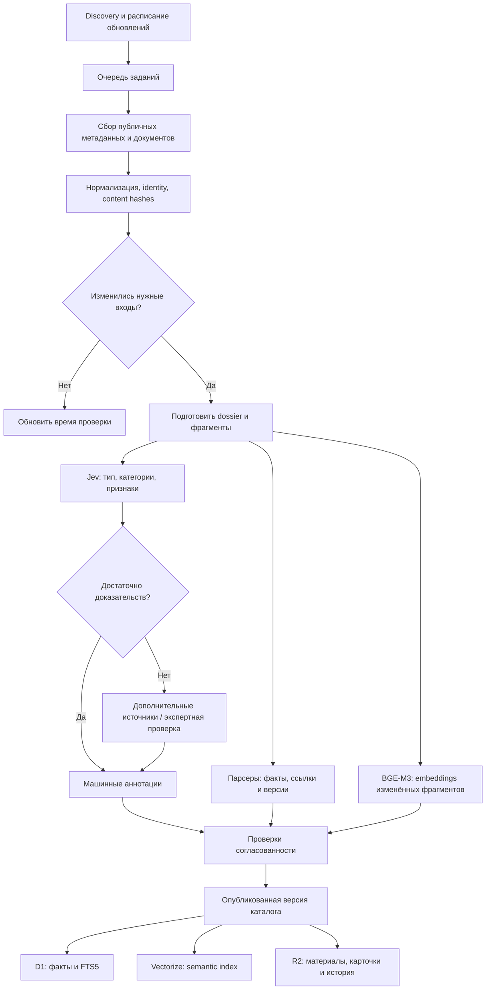

Стрелки к хранилищам здесь показывают логический результат публикации. Физически данные сначала записываются в подготовленную версию, проверяются, и только потом эта версия становится доступной поиску.

Распределение ответственности будет таким:

| Компонент | Кто выполняет работу | Ответственность |
|---|---|---|
| **Discovery / Scheduler** | Обычный код, Cron, при необходимости Workflows | Находит кандидатов, выбирает приоритеты обновления |
| **Collector** | Workers или внешние jobs для тяжёлых операций | Получает разрешённые публичные материалы, соблюдает квоты источников |
| **Normalizer / Parser** | Детерминированный код | Identity, aliases, hashes, даты, источники, разбиение документов |
| **Classifier** | Jev через сменный adapter | Предлагает категории и отдельные семантические признаки |
| **Evidence enrichment** | Парсеры; более сильная модель или куратор для сложных случаев | Уточняет существенные факты и основания классификации |
| **Indexer** | BGE-M3 + код индексации | Строит поисковые представления изменившихся материалов |
| **Publisher** | Проверки и код публикации | Обеспечивает согласованность версии каталога |
| **Retrieval service** | FTS5 + Vectorize + reranker | Возвращает ограниченные результаты с provenance |
| **Куратор** | Человек или отдельно принятый процесс проверки | Принимает спорные решения и изменения таксономии |
| **Observability** | Метрики и журналы | Ошибки, задержки, расходы, backlog, качество обновлений |

Это логические компоненты. Для первого релиза их можно реализовать в одном репозитории как API-приложение и фоновые обработчики, без отдельного микросервиса для каждого блока.

Машинная классификация должна сохраняться со своими основаниями:

```text
repository_id
source_revision / source_hash
taxonomy_revision
question_set_revision
requested_model
resolved_model_version
classification
probabilities
evidence_references
review_status
```

Так мы сможем ответить: «почему запись получила эту категорию?» и пересчитать только затронутые результаты после изменения модели, вопросника или таксономии.

Высокий score Jev не должен автоматически превращать `candidate` в curator-approved `accepted`. В проекте уже разделены статус каталога, стадия доказательств и пригодность для рекомендации; эту границу стоит сохранить. [Team contracts](C:/Users/user/Desktop/project/github_research/agentic-engineering-catalog/docs/plan/plugin-v1-team-contracts.md)

**BGE-M3 и reranker нужно включить в разные места системы.**

BGE-M3 создаёт embeddings при обновлении корпуса и при обработке поискового запроса. Upstream описывает multilingual-модель с размерностью 1 024, поддержкой dense, sparse и multi-vector retrieval. Но эти возможности исходной модели нельзя автоматически считать возможностями hosted API Cloudflare или Vectorize. [BGE-M3 model card](https://huggingface.co/BAAI/bge-m3)

Поэтому первый вариант поиска я предлагаю такой:

1. Независимый поиск по FTS5.
2. Независимый semantic search через Vectorize.
3. Объединение списков через RRF.
4. Проверка существенных ограничений по каноническим фактам.
5. Reranking ограниченного списка.
6. Группировка фрагментов по репозиториям и сбор evidence pack.

Например, для пилота можно проверить схему:

```text
100 lexical results + 100 semantic results
                  ↓
             merge и dedupe
                  ↓
       до 50 кандидатов для reranking
                  ↓
         5–10 репозиториев в ответе
```

Это предлагаемые параметры эксперимента, а не уже принятые лимиты.

У документации Cloudflare для BGE-M3 обнаружилось несоответствие: указано окно 60 000 токенов, тогда как upstream описывает 8 192; пример использует `text`, а таблица параметров — `query`/`contexts`. До интеграции нужно проверить фактические input/output, размерность, ограничения длины и поведение truncation. Архитектуру разумно сразу строить на небольших содержательных фрагментах. [Cloudflare BGE-M3](https://developers.cloudflare.com/workers-ai/models/bge-m3/)

Для `bge-reranker-base` есть отдельная языковая оговорка: upstream указывает **Chinese and English**. Для RU/EN-продукта следует сравнить исходный русский запрос, нормализованный английский технический запрос и multilingual-альтернативу. Высокий reranker score показывает релевантность текста, но не подтверждает совместимость, безопасность или пригодность к внедрению. [BGE reranker model card](https://huggingface.co/BAAI/bge-reranker-base)

**На пользовательском пути я поддерживаю подход Context7: компактные инструменты и skill, который объясняет агенту, когда ими пользоваться.**

Однако у нас будет дополнительная работа до обращения к серверу:

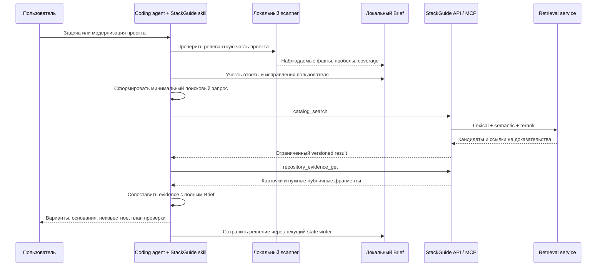

Здесь «локальный» означает место сканирования и хранения состояния. Модель coding agent продолжает работать в своей существующей среде; это не обещание полностью офлайн-инференса.

Ответственность клиента и сервера я бы закрепил так:

- **Scanner** обнаруживает факты о проекте и явно сообщает неполноту обследования.
- **Skill** задаёт порядок работы: уточнить цель, использовать актуальный Brief, запросить кандидатов, проверить доказательства, составить план.
- **Локальный код** формирует допустимую сетевую проекцию и проверяет её структуру.
- **Сервер** находит релевантные публичные материалы и возвращает их с версиями.
- **Coding agent** сопоставляет их с полным контекстом и объясняет решение пользователю.
- **Существующий writer** сохраняет результат и историю.

Skill сам по себе не обеспечивает контроль передачи данных. Проверки допустимых полей, размеров и доступа должны быть реализованы в клиенте и сервере.

**Полный Brief отправлять на сервер для этого не требуется.** Для поиска достаточно технической проекции, например:

```json
{
  "intent": "document_search",
  "technical_terms": ["TypeScript", "PostgreSQL", "RAG"],
  "constraints": {
    "deployment": ["self_hosted"],
    "gpu_available": false
  },
  "locale": "ru",
  "generation_id": "published-catalog-generation"
}
```

Это иллюстрация будущего контракта. В нём отсутствуют исходный код, локальные пути, названия внутренних сервисов, клиенты и история переписки. Полный контекст используется агентом после получения evidence.

Даже «очищенный Brief» нельзя просто сериализовать и отправить: текущие локальные структуры могут содержать ссылки на файлы и другие данные, необходимые только внутри проекта. В действующих permission contracts уже заложен минимальный публичный поисковый запрос для будущего MCP. [Permissions contract](C:/Users/user/Desktop/project/github_research/agentic-engineering-catalog/specs/decisions/plugin-v1-permissions.md:48)

Для первого API/MCP достаточно четырёх операций:

| Инструмент | Назначение |
|---|---|
| `catalog_manifest_get` | Версии каталога, контрактов, моделей и поддерживаемые возможности |
| `catalog_search` | Поиск кандидатов по минимальному структурированному запросу |
| `repository_evidence_get` | Получение ограниченных карточек и фрагментов по выбранным ID |
| `catalog_changes_get` | Изменения, исправления и отзывы ранее опубликованных записей |

REST API, MCP и сайт должны обращаться к **одной доменной логике**. Тогда исправление ранжирования или проверки provenance одинаково действует для всех клиентов.

Для нового remote MCP Cloudflare рекомендует stateless Streamable HTTP handler. Состояние пользовательского проекта можно оставить на клиенте; отдельный долговечный серверный агент на каждую сессию для базового поиска не требуется. [Cloudflare MCP transport](https://developers.cloudflare.com/agents/model-context-protocol/protocol/transport/)

Операции обновления каталога, запуска enrichment и curator acceptance следует оставить во внутреннем административном интерфейсе. Пользовательский поиск получает уже опубликованные знания.

**С точки зрения расходов твоя идея с Jev выглядит убедительно, но экономию нужно считать по всему процессу.**

Опубликованные цены на проверенных страницах:

| Модель | Цена за 1 млн входных токенов |
|---|---:|
| Jev | $0,042 |
| BGE-M3 | $0,0118 |
| BGE reranker base | $0,00311 |

Источники: [Jev](https://developers.cloudflare.com/ai/models/typesafe/jev/), [BGE-M3](https://developers.cloudflare.com/workers-ai/models/bge-m3/), [BGE reranker](https://developers.cloudflare.com/workers-ai/models/bge-reranker-base/). Общая таблица Workers AI округляет некоторые значения. [Workers AI pricing](https://developers.cloudflare.com/workers-ai/platform/pricing/)

Для понимания порядка величин:

| Иллюстративная обработка | Расчёт | Только модельный inference |
|---|---|---:|
| Один проход Jev по 100 000 репозиториям | 2 000 входных токенов на запись, включая вопросы | **$8,40** |
| Более подробный проход Jev | 10 000 токенов на запись | **$42,00** |
| Первичная векторизация | 100 000 × 8 фрагментов × 500 токенов | **$4,72** |

Это арифметика по опубликованным тарифам, **не смета запуска каталога**. Здесь нет сбора данных, хранения, операций индексов, повторов, экспертного разбора сложных случаев и генерации подробных материалов. Фактический расход токенов нужно брать из `usage`, включая определения категорий и вопросы.

Основные способы экономии я вижу такими:

- повторно обрабатывать только изменившиеся входы;
- классифицировать публичные материалы при обновлении, а не при каждом поиске;
- объединять независимые вопросы к одному dossier;
- использовать парсеры для точных структурированных фактов;
- направлять дорогую обработку только на случаи, где дополнительная информация меняет решение;
- составлять персональный отчёт в coding agent пользователя;
- повторно использовать одинаковые публичные evidence packs.

Я бы также включил в сравнительный пилот **Cloudflare Clef-flash**. На 9 октября Cloudflare объявил цену $0,038 за миллион входных токенов для этой модели решений. Разница в цене с Jev небольшая; выбирать нужно по ошибкам, скорости и доле случаев, требующих дополнительной проверки. Поэтому classifier должен иметь сменный adapter. [Cloudflare Clef update](https://developers.cloudflare.com/changelog/post/2026-10-09-clef-omni-workers-ai/)

**Чтобы эта архитектура оставалась надёжной при росте, нужны несколько явных правил.**

- Результат поиска и последующее получение evidence относятся к одной версии каталога.
- Изменение модели, taxonomy или вопросника делает соответствующие машинные аннотации кандидатами на пересчёт.
- Изменение stars само по себе не запускает повторную векторизацию README.
- Повторная доставка задания не создаёт дубликаты и повторную платную обработку без необходимости.
- Ошибка reranker допускает только явно обозначенный fallback; ошибка сервиса не превращается в «ничего не найдено».
- Отзыв ошибочного факта учитывается в новых рекомендациях, при этом сохранённая история показывает, какие доказательства использовались раньше.
- Текущий local FTS5 и будущий hosted hybrid имеют разные честно обозначенные режимы и версии контрактов.

В существующем C9 есть жёсткие значения `catalog_only` и `sqlite_fts5`. Серверный hybrid-путь потребует нового внешнего контракта или явной версии расширения; переименовать движок внутри текущего ответа незаметно нельзя. [C9 query schema](C:/Users/user/Desktop/project/github_research/agentic-engineering-catalog/specs/retrieval/catalog-query.schema.json)

**Первый проверочный этап я предлагаю сделать узким и измеримым.**

| Проверка | Что сравниваем | Что должно стать известно |
|---|---|---|
| Классификация | Простые правила, Jev, Clef-flash на одинаковых dossiers | Precision, macro-F1, ошибки редких категорий, доля автоматической обработки |
| Неопределённость | Вероятности моделей против экспертной разметки | Какие пороги позволяют безопасно принимать аннотации |
| Retrieval | FTS5 → hybrid → hybrid + reranker | Recall, nDCG, RU/EN-качество, p95 и стоимость запроса |
| Hosted API моделей | Реальные input/output и ограничения | Форматы, длины, размерности, truncation, usage, ошибки |
| API/MCP + skill | Полный путь от скана до сохранённой рекомендации | Полезность ответа, отсутствие лишних передач данных, правильность версий |
| Обновления | Изменение, удаление, rename, повтор задания и сбой | Согласованность каталога и восстановление |

В разметку обязательно должны войти неоднозначные проекты, несколько подходящих категорий, неполная документация, противоречивые заявления и инструкции внутри README, пытающиеся повлиять на классификатор. Качество нужно проверять на отложенной выборке, отдельно от примеров, по которым настраивались вопросы.

**Моя рекомендация для первой версии архитектуры:** Cloudflare Workers + D1/FTS5 + R2 + Queues, BGE-M3/Vectorize как проверяемое расширение поиска, Jev как основной кандидат на классификацию, reranker после проверки языкового качества, четыре read-only API/MCP-инструмента и локальный skill со scanner/Brief. Персональное объяснение и интеграционный план составляет coding agent, используя полный контекст проекта и ограниченный набор серверных доказательств.

Следующий конкретный результат проектирования — контракт минимального поискового запроса, серверного ответа и машинной аннотации Jev, вместе с небольшим сравнительным набором примеров. Это позволит проверить наиболее рискованные предположения до обработки 100 000 репозиториев.

В этой работе выполнены изучение публичной документации, проверка существующих контрактов, расчёты и точное дополнение Markdown-архива. Вызовы моделей, изменение Cloudflare-аккаунта, активация MCP и развёртывание не выполнялись; фактические скорость, точность и расходы нашего pipeline ещё предстоит измерить.

<oai-mem-citation>
<citation_entries>
MEMORY.md:74-82|note=[Used prior StackGuide lifecycle boundaries for orientation; current architecture checked against repository contracts]
</citation_entries>
<rollout_ids>
01a14b8d-cd65-7de1-ba60-23959631e2cd
</rollout_ids>
</oai-mem-citation>

---

Предыдущий ответ **полностью, без сокращений добавлен в тот же [Markdown-файл](C:/Users/user/Desktop/project/github_research/agentic-engineering-catalog/research/stackguide-100k-architecture-answer-2026-10-20.ru.md)**. Проверил сохранение исходного текста; в файле теперь 941 строка.

**Я рекомендую строить StackGuide вокруг двух независимых индексов: публичного каталога решений и локального паспорта проекта пользователя.** Между ними передаётся небольшой поисковый запрос. Product-Agent-OS поможет превратить человеческое пожелание в этот запрос, а общий scanner и адаптеры позволят работать с разными агентами.

Ниже — результаты исследования и предлагаемая архитектура. Это проектирование: новые scanner, интеграции и облачные компоненты пока не реализованы.

**Главная экономия возникает, когда мы разделяем обновление знаний, поиск и персонализацию.**

У нас есть три разных процесса с разной периодичностью:

| Процесс | Когда выполняется | Что обрабатывает |
|---|---|---|
| Обновление публичного каталога | При добавлении источников и обнаружении изменений | Новые и изменившиеся сведения о репозиториях |
| Анализ проекта пользователя | При первом подключении, изменениях и появлении новой задачи | Ограниченную часть локального проекта |
| Поиск рекомендации | На каждый запрос | Готовые индексы, небольшой набор кандидатов и краткий контекст |

Число репозиториев влияет на размер индексов и стоимость их обслуживания. Оно **не должно превращаться в число репозиториев, отправляемых модели при каждом поиске**.

Предлагаемый процесс:

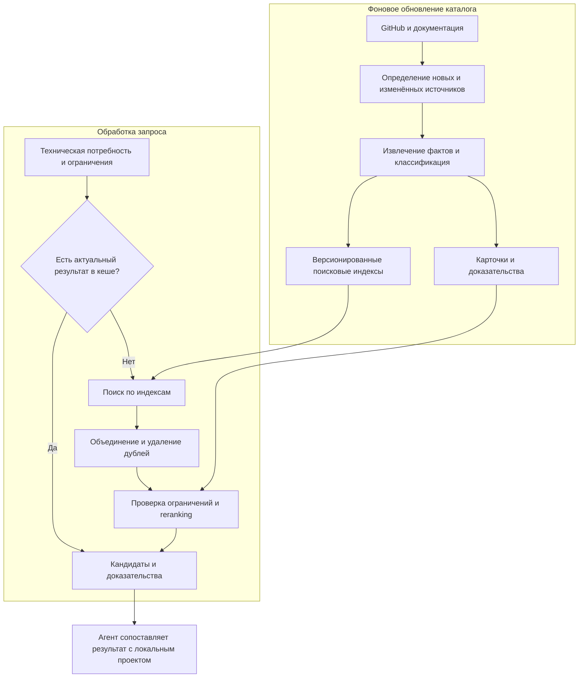

Для первого варианта можно исследовать такие **экспериментальные бюджеты**, затем подобрать их по качеству:

- до трёх формулировок поискового запроса;
- до 150 кандидатов после объединения поисковых веток;
- до 40–60 кандидатов для reranker;
- 5–12 подробных карточек для окончательного сравнения;
- дополнительное чтение документации только по конкретному пробелу.

Часть подобных ограничений уже есть в нашей [retrieval policy](C:/Users/user/Desktop/project/github_research/agentic-engineering-catalog/specs/retrieval/retrieval-policy.json:32). Однако текущая политика относится к локальному поиску; параметры облачного поиска предстоит проверить отдельно.

Для иллюстрации: если давать модели по 500 токенов на каждый из 100 000 репозиториев, получится 50 млн входных токенов. Если reranker получает 50 карточек по 500 токенов — 25 000 токенов. Это арифметическое сравнение объёмов **одного этапа**, а не обещание удешевить весь сервис в 2000 раз: остаются индексы, первоначальная загрузка, обновления и другие расходы.

Поиск по индексу также не имеет «нулевой стоимости». `topK=50` ограничивает возвращаемый результат, но не всю внутреннюю работу поискового движка.

**Поисковые ветки должны дополнять друг друга, чтобы экономия не уничтожила полезные результаты.**

Я предлагаю сочетать:

1. **Точный поиск:** названия библиотек, package identifiers, языки, лицензии, поддерживаемые интеграции.
2. **Полнотекстовый поиск:** слова из описаний, capabilities, ограничений и документации.
3. **Семантический поиск:** соответствие пользовательской задаче, даже если терминология отличается.
4. **Проверку совместимости:** подтверждённые требования пользователя и имеющиеся факты о кандидатах.
5. **Reranking:** уточнение порядка небольшого набора результатов.

Не следует сначала выбирать одну категорию и навсегда ограничивать поиск ею. Например, задача «согласование заявок» может решаться через workflow engine, автоматизацию бизнес-процессов, BPM или уже существующий компонент проекта.

Аналогично, краткая карточка репозитория может не содержать важной возможности, описанной в документации. Поэтому полезно объединять результаты поиска по карточкам и по фрагментам документации, а затем удалять дубли.

Jev здесь уместен прежде всего в **фоновом pipeline классификации новых и изменившихся материалов**. Если задача решается правилами или поиском, модель вызывать не нужно. Классификация запроса небольшой моделью возможна, но её пользу следует сравнить с интерпретацией запроса уже работающим агентом пользователя.

Для обслуживания каталога предлагаю следующие правила:

| Что изменилось | Что пересчитываем |
|---|---|
| Stars, количество issues | Метаданные и зависящие от них сигналы |
| README или выбранная документация | Изменившиеся фрагменты, их факты и embeddings |
| Лицензия, архивирование, удаление проекта | Допустимость кандидата и связанные рекомендации |
| Правила классификации | Затронутые классификационные поля |
| Embedding model или способ формирования embeddings | Соответствующий индекс; возможна полная миграция |
| Пользовательская цель | Поисковый запрос и подбор контекста, без обязательного повторного чтения всего проекта |

Обновления по запросу пользователя стоит объединять в очереди: если десять человек запросили устаревшую карточку, это одна задача обновления источника. Периодическая сверка всё равно нужна для обнаружения удалений и пропущенных изменений.

Обнаружил и конкретный участок модернизации у нас: сейчас retrieval хеширует весь локальный индекс, а evidence pack проверяет полный снимок каталога. Для облачной версии нужно проверять целостность при публикации неизменяемой версии данных, сохранять привязку ответа к этой версии и получать выбранные карточки напрямую. Это позволит убрать полный проход из каждого запроса, сохранив проверяемое происхождение данных. Источники: [retrieval.py](C:/Users/user/Desktop/project/github_research/agentic-engineering-catalog/plugins/myai-stackguide/scripts/retrieval.py:545), [context_pack.py](C:/Users/user/Desktop/project/github_research/agentic-engineering-catalog/plugins/myai-stackguide/scripts/context_pack.py:423).

**Исследование сообществ показывает спрос на сохранение полезного контекста, но не даёт готовой цифры экономии.**

Я изучил OpenAI Developer Community, публичные обсуждения Claude Code, его GitHub issues и проекты, работающие с контекстом репозитория.

| Источник | Что обнаружено | Вывод для StackGuide |
|---|---|---|
| OpenAI Community: [локальная индексация и сокращение контекста](https://community.openai.com/t/could-codex-reduce-inference-costs-through-local-repository-indexing-and-context-pruning/1389046) | Пользователь предлагает локальную карту репозитория, устранение дублей и выбор релевантных фрагментов. Проценты экономии представлены как гипотеза | Измерять стоимость завершённой задачи и качество, а не обещать экономию по числу удалённых токенов |
| OpenAI Community: [контекст между сессиями](https://community.openai.com/t/how-do-you-preserve-project-context-across-codex-sessions-in-a-large-codebase/1387550) | Обсуждаются повторное изучение архитектуры и устаревание накопленных заметок | Сохранять факты со ссылками на источники и правилами актуализации |
| Claude Code: [сообщение о повторном чтении неизменённого файла](https://github.com/anthropics/claude-code/issues/100265) | Пользователь сообщил о повторной выдаче полного содержимого файла в конкретной версии на Windows | Собственный кеш фактов не должен зависеть исключительно от поведения истории чата или инструмента Read |
| Сообщество Claude: [использование Claude Code для нетехнических задач](https://www.reddit.com/r/ClaudeAI/comments/1q403xw/claude_code_for_noncoding_projectswork_a_complete/) | Пользователи описывают работу с документами, знаниями и повседневными процессами через разговорный интерфейс | Начинать с результата и рабочего процесса; технические термины должны появляться по мере необходимости |

Это пользовательские сообщения, а не подтверждение универсальных дефектов или статистика рынка. В частности, количество `cached input tokens` нельзя автоматически трактовать как столько же новых чтений файлов или как равную им долю денежного счёта.

На GitHub полезны три разных подхода:

- **[Aider](https://aider.chat/docs/repomap.html):** компактная карта символов и связей; выбор релевантной части карты в пределах бюджета контекста. Для нас полезен принцип «общая карта + подробности по задаче».
- **[Serena](https://github.com/oraios/serena):** поиск символов, ссылок и структуры через language servers и MCP. Это кандидат для дополнительного глубокого анализа сложных проектов; поддержка конкретного языка зависит от backend.
- **[Repomix](https://github.com/yamadashy/repomix):** выбор файлов, структурное извлечение через Tree-sitter, поиск по подготовленному представлению. Для нас полезны управляемый состав контекста и компактное представление. Автоматическая упаковка всего проекта не должна становиться обязательным шагом.

Я предлагаю сначала заимствовать эти **инженерные принципы**. Решение подключить конкретную зависимость потребует проверки лицензии, поведения, стоимости запуска и совместимости с нашим scanner.

**Проект пользователя стоит анализировать постепенно, сохраняя проверяемый паспорт.**

Паспорт проекта — небольшой локальный набор фактов, который можно переиспользовать между задачами и агентами. В нём нужны:

- обнаруженные языки, frameworks и зависимости;
- компоненты проекта и связи, существенные для выбора решений;
- подтверждённые пользователем цели и ограничения;
- источник каждого наблюдения;
- версии scanner/parser и сведения об актуальности;
- явно обозначенные неизвестные и границы анализа.

Предлагаемый процесс:

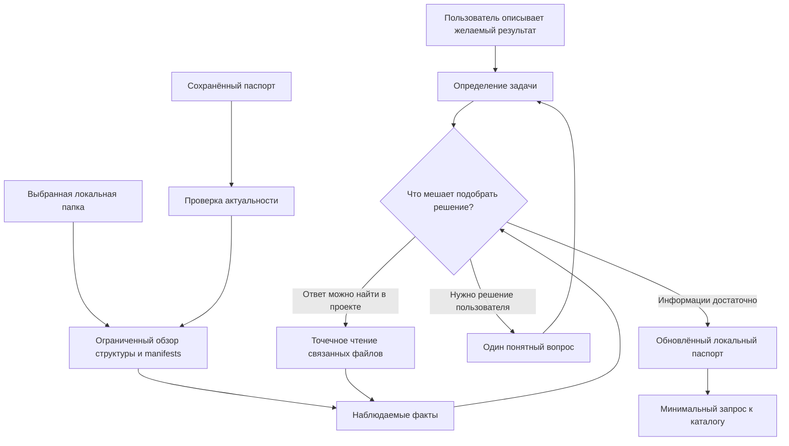

Глубину анализа предлагаю выбирать так:

| Уровень | Что делаем | Когда достаточно |
|---|---|---|
| Описание без кода | Цель, ограничения, ответы пользователя | Идея продукта или проект ещё не создан |
| Обзор | Manifests, lockfiles, границы workspace, основные конфигурации | Подбор класса решений и первичная совместимость |
| Анализ по задаче | Связанные модули, интерфейсы, схемы, точки интеграции | Сравнение нескольких подходящих вариантов |
| Углубление | Дополнительные связи и конкретные фрагменты | Остался вопрос, который меняет рекомендацию |

Например, для выбора системы уведомлений обычно не требуется подробно читать модуль финансовой отчётности.

При повторном обращении scanner проверяет изменения и переиспользует актуальные факты. Важно учитывать рабочие изменения, новые неотслеживаемые файлы, удаления, переименования и смену ветки. Одного commit SHA недостаточно. Изменение workspace manifest может потребовать пересмотра структуры целого поддерева.

Некоторая проверка файловой структуры всё равно останется. Экономия заключается в том, что мы не повторяем без необходимости чтение содержимого, parsing и передачу этого содержимого модели.

В нашем scanner уже есть профили глубины, ограничения чтения, исключения и подбор контекста по цели. Но существующий restart checkpoint **ещё не является постоянным инкрементальным индексом между сессиями**. Такой механизм нужно спроектировать отдельно. Источники: [scan-policy.yaml](C:/Users/user/Desktop/project/github_research/agentic-engineering-catalog/specs/scanner/scan-policy.yaml:4), [scanner.py](C:/Users/user/Desktop/project/github_research/agentic-engineering-catalog/plugins/myai-stackguide/scripts/scanner.py:1506).

**Новичок и профессионал должны приходить к одному формату задачи разными путями.**

Профессионал может сразу сказать:

> Нужен self-hosted workflow engine с TypeScript SDK и поддержкой длительных процессов.

Новичок может сказать:

> Хочу, чтобы сотрудники согласовывали заявки, а система напоминала тем, кто задерживает ответ.

Для второго пользователя StackGuide должен сам сформировать предварительные технические потребности: состояния процесса, согласование, роли, напоминания, история действий. Затем выяснить только то, что действительно меняет выбор.

Например:

| Техническое понятие | Понятная пользователю формулировка |
|---|---|
| Длительный workflow | «Согласование может продолжаться несколько дней?» |
| Требования к размещению данных | «Информацию можно хранить у внешнего сервиса или она должна оставаться у вас?» |
| Audit trail | «Нужно видеть, кто и когда согласовал или отклонил заявку?» |
| Интеграционные ограничения | «Какие уже используемые сервисы обязательно сохранить?» |

Сначала scanner и доступные материалы отвечают на технические вопросы. Пользователю остаются вопросы о намерении, приоритетах и допустимых компромиссах.

При этом наличие зависимости в manifest не доказывает, что функция работает. Отсутствие найденного файла не доказывает отсутствие функции, если анализ был неполным. В паспорте нужно различать:

- **наблюдение:** найденная зависимость или конфигурация;
- **слова пользователя:** подтверждённое требование;
- **предположение:** вероятное назначение компонента;
- **неизвестное:** недостаточно данных.

Полезной рекомендацией может оказаться и «использовать уже имеющийся компонент». Это уменьшает ненужное расширение stack и становится частью ценности продукта.

**Из Product-Agent-OS стоит выделить переносимый метод понимания проекта.**

В исходниках Product-Agent-OS уже есть полезные механизмы:

| Механизм | Как использовать в StackGuide |
|---|---|
| Discovery по наблюдаемым признакам | Получать предварительный технический профиль без анкеты на десятки вопросов |
| Очередь вопросов | Показывать следующий вопрос, влияющий на решение |
| Ledger ответов | Помнить подтверждённые ограничения и обнаруживать устаревшие ответы |
| Выбор глубины работы | Упрощать процесс для небольшого проекта и расширять для сложного |
| Разделение фактов и предположений | Давать объяснимую рекомендацию с обозначенными пробелами |

Это подтверждено текущими [discovery.py](C:/Users/user/Desktop/project/codex_docs/plugins/product-agent-os/scripts/product_agent_os/discovery.py:3977), [question_protocol.py](C:/Users/user/Desktop/project/codex_docs/plugins/product-agent-os/scripts/product_agent_os/question_protocol.py:12) и [question_ledger.py](C:/Users/user/Desktop/project/codex_docs/plugins/product-agent-os/scripts/product_agent_os/question_ledger.py:21).

Часть направления уже присутствует в StackGuide: наш [question-bank.json](C:/Users/user/Desktop/project/github_research/agentic-engineering-catalog/plugins/myai-stackguide/assets/question-bank.json:6) начинается с желаемого результата и первого наблюдаемого успеха.

Для переносимости предлагаю три слоя:

1. **Общее ядро:** scanner, паспорт, очередь вопросов, выбор контекста, подготовка поискового запроса. Без зависимости от Codex SDK и конкретной модели.
2. **Адаптер среды:** получение разрешённой папки, запуск локального инструмента, отображение вопроса, передача ответа, отображение результата.
3. **Веб-сервис:** каталог, поиск, доказательства, обновления и учёт использования.

Такой подход имеет практический пример: официальный [OpenAI Developers plugin](https://developers.openai.com/learn/developers-codex-plugin) использует переносимые skills и общий Docs MCP, при этом адаптации для Claude Code и Cursor отличаются от Codex-компонентов.

Но одинаковый `SKILL.md` не гарантирует одинаковое исполнение. Claude Code поддерживает Agent Skills и собственные расширения; документация прямо различает переносимые поля и специфичные возможности. Поэтому конфигурации, разрешения и вызовы инструментов нужно проверять в каждой среде. [Документация Claude Code](https://code.claude.com/docs/en/skills).

Текущий StackGuide пока нельзя объявить универсальным: политика закрепляет Windows, а полный entrypoint требует CPython 3.14. Эти ограничения видны в [scan-policy.yaml](C:/Users/user/Desktop/project/github_research/agentic-engineering-catalog/specs/scanner/scan-policy.yaml:4) и [intake.py](C:/Users/user/Desktop/project/github_research/agentic-engineering-catalog/plugins/myai-stackguide/scripts/intake.py:396).

**Я вижу четыре жизнеспособных варианта подключения пользователя.**

| Вариант | Как анализируется проект | Что поступает на наш сервер | Преимущество | Основной недостаток |
|---|---|---|---|---|
| **A. Skill + инструменты существующего агента** | Codex, Claude Code или другой агент читает проект доступными ему средствами | Краткий профиль задачи и ограничения | Самый быстрый путь к первому продукту | Качество и расход контекста зависят от поведения агента |
| **B. Общий локальный scanner + адаптеры** | Наш детерминированный инструмент строит и обновляет паспорт; агент помогает понять цель | Проверенная минимальная проекция паспорта | Стабильные факты, повторное использование, контроль состава данных | Нужно поддерживать установку, ОС и runtime |
| **C. Веб-интерфейс с локальным анализом в браузере** | Пользователь выбирает папку; браузер извлекает ограниченный профиль | Выбранные факты и введённые на сайте пожелания | Подходит новичку без IDE и собственного агента | Ограничения браузеров и меньшая глубина анализа |
| **D. Облачное подключение через GitHub App** | Наш сервис читает разрешённый репозиторий и обрабатывает изменения | Содержимое разрешённых файлов репозитория | Удобство подключения и обновления без работающего локального клиента | Выше расходы и ответственность за приватные исходники; не видит локальные несохранённые в GitHub изменения |

Архитектурно они выглядят так:

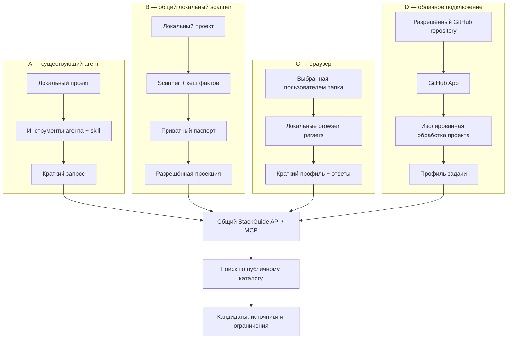

**Вариант A** хорош для проверки спроса. Пользователь устанавливает небольшую skill, агент формирует запрос и получает evidence pack. Сервер может обходиться без генерации длинного персонального ответа: объяснение формирует агент пользователя. Это уменьшает наши расходы на генерацию, но расходует его модельный бюджет.

Ограничение A: текст skill не обеспечивает техническое соблюдение правил передачи данных. Строгую проверку исходящего пакета лучше выполнять кодом.

**Вариант B — моя рекомендация для основного продукта.** Общий локальный инструмент предоставляет операции анализа, обновления паспорта и подготовки запроса. Агент вызывает его через CLI или локальный MCP. Удалённый MCP обращается к каталогу. Это две разные роли: доступ к локальной файловой системе обеспечивается локальной средой, а не самим фактом подключения к нашему веб-сервису.

Здесь можно поддерживать Codex, Claude Code, Cursor и другие среды через тонкие адаптеры. Для агента без MCP остаётся CLI или импорт краткого файла с профилем.

**Вариант C** полезен как вход для новичков. На сайте доступны описание задачи и кнопка выбора папки. Начать можно с manifests и конфигураций, не пытаясь перенести весь scanner в браузер. `showDirectoryPicker()` требует действия пользователя и имеет ограничения совместимости, поэтому нужен запасной путь через выбор файлов или импорт профиля. [MDN](https://developer.mozilla.org/en-US/docs/Web/API/Window/showDirectoryPicker).

Здесь важно различать локальное чтение файлов браузером и отправку на сервер. Если диалог ведёт наша серверная модель, введённый пользователем текст также поступает в сервис; это должно быть понятно из интерфейса.

**Вариант D** я бы оставил для отдельного этапа. GitHub App позволяет задавать права, от которых зависят доступные API и webhooks. Для такого продукта следует ограничивать доступ выбранными репозиториями и необходимым чтением. [GitHub Docs](https://docs.github.com/en/apps/creating-github-apps/registering-a-github-app/choosing-permissions-for-a-github-app).

Этот вариант лучше подходит для командного продукта с фоновыми проверками. Он требует отдельного хранения приватных данных, сроков удержания, удаления при отключении и изоляции проектов от публичного каталога.

**Для основного варианта B на сервер следует передавать поисковую проекцию, достаточную для подбора кандидатов.**

Например, такой **предлагаемый формат**, ещё не существующий API:

```json
{
  "schema_version": "proposal-1",
  "intent": {
    "capabilities": [
      "approval_workflows",
      "scheduled_notifications"
    ],
    "stage": "extend_existing_project"
  },
  "stack": [
    {
      "name": "typescript",
      "basis": "observed"
    },
    {
      "name": "postgresql",
      "basis": "observed"
    }
  ],
  "constraints": {
    "deployment": "self_hosted",
    "deployment_basis": "user_confirmed",
    "license_policy": "unknown"
  },
  "context_coverage": {
    "manifests": "checked",
    "integration_surfaces": "partial"
  },
  "response_language": "ru"
}
```

| Данные | Где предлагаю хранить и использовать |
|---|---|
| Исходный код, локальные пути, имена внутренних сервисов | Локально |
| Полный приватный паспорт, ответы с деловыми подробностями | Локально в варианте B |
| Технические capabilities, существенные зависимости и ограничения | В запросе к сервису |
| Версии зависимостей | Только когда нужны для совместимости |
| Неизвестные факты и степень покрытия анализа | В сокращённом виде в запросе |
| Ключи, `.env`, персональные данные, история чата | Не включать в поисковый пакет |
| Результаты и источники публичного каталога | Сервер возвращает клиенту |

Даже такой пакет может раскрывать особенности проекта. Его корректнее называть **минимизированным**, а не гарантированно анонимным.

Нужен allowlist полей и допустимых значений. Одной просьбы к модели «удали секреты» недостаточно. Частные package names и исходный текст бизнес-задачи не должны автоматически попадать в поля публичного поиска.

В ответ сервис возвращает:

- идентификаторы кандидатов и версию каталога;
- подтверждённые capabilities;
- источники и даты наблюдений;
- обнаруженные ограничения;
- неизвестные условия совместимости.

Агент сопоставляет эти данные с полным локальным паспортом и объясняет пользователю, почему вариант подходит, что придётся изменить и что ещё проверить.

**Кеши должны иметь разные области действия и правила устаревания.**

| Кеш | Когда можно переиспользовать | Что отменяет результат |
|---|---|---|
| Локальные факты | Источники и правила извлечения остаются актуальными | Изменение файла, удаление, новая parser/policy version |
| Ответы пользователя | Сохраняются цель и условия | Исправление ответа или изменение задачи |
| Публичный поиск | Совпадают нормализованный запрос и версии поисковых данных | Изменение индекса или влияющей на результат политики |
| Персональная рекомендация | Совпадают версия Brief, ограничения и evidence | Изменения проекта, намерения или источников |

Общий кеш публичного поиска не должен содержать приватные тексты пользователей. Персональные результаты изолируются по пользователю или организации.

Не стоит начинать с приблизительного кеширования готовых ответов по «похожим запросам»: два похожих пожелания могут иметь разные ограничения на размещение данных или лицензии. Сначала лучше точное кеширование нормализованных запросов.

**Я бы модернизировал продукт в следующем порядке.**

| Этап | Конкретный результат | Основной владелец | Как проверить |
|---|---|---|---|
| 1. Общий контракт задачи | Формат локального паспорта, поисковой проекции и ответа сервиса | Catalog Architect + Product Planner | Профессиональный запрос и разговорное пожелание приводят к сопоставимым требованиям |
| 2. Повторное использование контекста | Инкрементальный кеш scanner и корректное устаревание фактов | Plugin Runtime Builder | Результат после изменений совпадает с чистым анализом при одинаковом охвате |
| 3. Работа в нескольких средах | Адаптеры Codex и Claude Code поверх одного ядра | Runtime Builder + Quality Evaluator | Одинаковые факты, границы чтения и формат запроса на одних fixtures |
| 4. Облачный поиск | Версионированные индексы и выборочные evidence packs | Catalog Pipeline Builder + backend owner | Качество кандидатов, задержка и стоимость на корпусе 100 000+ |
| 5. Вход для новичков | Короткий диалог и браузерный обзор проекта | Product Planner + UI owner | Пользователь получает полезный выбор без знания архитектурной терминологии |
| 6. Облачные проекты | GitHub App и изолированная обработка | Отдельный backend/security slice | Изоляция, актуализация, отключение доступа и стоимость обслуживания |

Для измерения эффекта нужны четыре группы показателей:

- **Экономика:** первоначальная индексация, ежедневные обновления, стоимость запроса и завершённого подбора.
- **Качество:** попадание подходящих решений в кандидаты до reranking, полезность финального выбора, число пропущенных ограничений.
- **Scanner:** объём прочитанных данных, доля переиспользованных фактов, корректность после удаления и добавления файлов.
- **Пользовательский результат:** сколько уточнений понадобилось и смог ли человек понять следующий шаг.

Мой выбор для продукта — **B как техническая основа, C как удобный вход для новичков и A как быстрый способ проверить сценарии в существующих агентах**. D имеет смысл добавлять при подтверждённом спросе команд на постоянный облачный анализ.

Исследование и проверка исходников выполнены; архив ответа обновлён. Реальная экономия, качество рекомендаций и работа между разными агентами пока не измерены. Следующий практический результат — небольшой прототип одного сценария на общем паспорте проекта, выполненный в Codex и Claude Code с одинаковыми входными данными и учётом стоимости.

<oai-mem-citation>
<citation_entries>
MEMORY.md:74-82|note=[Prior StackGuide lifecycle context used for orientation and checked against current source]
</citation_entries>
<rollout_ids>
01a14b8d-cd65-7de1-ba60-23959631e2cd
</rollout_ids>
</oai-mem-citation>

---

Предыдущий ответ **сохранён полностью, без сокращений**, в том же [Markdown-файле](C:/Users/user/Desktop/project/github_research/agentic-engineering-catalog/research/stackguide-100k-architecture-answer-2026-10-20.ru.md). Проверил точность добавленного текста и UTF-8; теперь в файле 1324 строки.

**Для StackGuide я рекомендую локальный движок знаний о проекте: детерминированный scanner собирает факты, небольшой граф связывает их, а карточки знаний объясняют назначение компонентов.** Агент получает выбранную часть этих знаний. Наш веб-сервис по умолчанию получает только техническую потребность и ограничения для поиска.

После изучения трёх источников вижу, что они дополняют друг друга:

- **Context7** показывает, как выдавать агенту нужные внешние знания через небольшой API, CLI и MCP.
- **Qoder** показывает, как накапливать несколько видов знаний о проекте и обновлять затронутые части.
- **Product-Agent-OS** даёт основу для происхождения фактов, структурного анализа, ограниченных запросов к графу и фиксации решений пользователя.

Ниже отделяю подтверждённые возможности этих проектов от предлагаемой архитектуры StackGuide.

**Из Context7 полезнее всего взять двухэтапное получение контекста и независимость от конкретного агента.**

В текущем интерфейсе Context7 сначала определяется библиотека через `resolve-library-id`, затем нужная документация извлекается через `query-docs`. Если идентификатор уже известен, первый шаг можно пропустить. Аналогичные операции доступны через CLI, поэтому MCP не является обязательным способом подключения. [Репозиторий Context7](https://github.com/upstash/context7), [CLI Reference](https://context7.com/docs/clients/cli).

Для нашего локального scanner это можно преобразовать в такой интерфейс:

| Предлагаемая операция | Что возвращает |
|---|---|
| `project_overview` | Stack, компоненты, актуальность и границы анализа |
| `project_context_search` | Подходящие карточки и ссылки на наблюдения по задаче |
| `project_evidence_get` | Подробности выбранных наблюдений; чтение исходника — только локально и по необходимости |
| `project_changes_get` | Изменения относительно конкретной версии анализа |

Агент сначала получает обзор, затем выбирает нужные сведения. Передавать весь граф или все карточки при каждом обращении не требуется.

Ещё две полезные техники:

- **Приоритет документации и явное управление областью чтения.** Context7 преимущественно индексирует документацию; при её недостатке может генерировать материалы из кода. Для приватных репозиториев этот режим включается отдельно. Область обработки управляется настройками, включая `context7.json`. Для нас это аргумент в пользу отдельного плана анализа: какие подсистемы нужны и насколько глубоко их изучать. [Adding Libraries](https://context7.com/docs/adding-libraries).
- **Повторное использование неизменившегося материала.** В документации приватных источников Context7 описано повторное использование кешированных страниц при обновлении. Нам стоит применять этот принцип к извлечённым фактам и карточкам проекта. [Private Sources](https://context7.com/docs/howto/private-sources).

При этом открытый MCP-интерфейс Context7 нельзя считать готовым scanner локального пользовательского проекта. Он прежде всего показывает способ обращения к знаниям.

**У Qoder полезно заимствовать разделение знаний по назначению.**

В Knowledge Engine выделены три вида:

| Вид знаний Qoder | Что переносим в StackGuide |
|---|---|
| **Repo Wiki** | Читаемое объяснение архитектуры и подсистем |
| **Knowledge Cards** | Небольшие структурированные единицы знаний для агента |
| **Memory** | Решения, предпочтения и опыт, которые нельзя получить только из кода |

Это позволяет не смешивать описание архитектуры, извлечённые технические факты и пожелания человека в один длинный документ. [Knowledge Engine Overview](https://docs.qoder.com/user-guide/knowledge-engine/overview).

В Repo Wiki документированы обновление затронутых частей, настройка области анализа через `wiki_plan.yaml` и сохранение ручных исправлений при последующих обновлениях. Результаты сохраняются в `.qoder/repowiki`; предусмотрено командное распространение. Для StackGuide я бы перенёс управление областью анализа и защиту человеческих правок, но хранил бы такие правки отдельным слоем. [Repo Wiki](https://docs.qoder.com/user-guide/repo-wiki).

Например:

> Scanner обнаружил SQLite. Пользователь сообщил, что целевая архитектура должна использовать PostgreSQL.

Здесь нужно сохранить **два разных утверждения**: наблюдаемое текущее состояние и целевое требование. Повторное сканирование не должно уничтожать требование, а требование — переписывать наблюдение.

Knowledge Cards у Qoder содержат архитектуру, спецификации и stack; документация описывает отслеживание изменений и редактирование карточек. Для нас это хороший образец компактного контекста по компонентам. [Knowledge Cards](https://docs.qoder.com/user-guide/knowledge-engine/knowledge-cards).

Есть существенная граница обработки данных:

- **Codebase Indexing:** необходимые файлы отправляются в облако для построения векторов; согласно документации, после обработки исходники удаляются, а векторы остаются в облаке.
- **Repo Wiki:** описана локальная оркестрация агентов и хранение результатов в репозитории. Формулировка об отсутствии загрузки *всего* репозитория сама по себе не означает, что ни один выбранный фрагмент не передаётся модельному провайдеру.

Поэтому нельзя объединять эти функции в обещание «Qoder полностью анализирует код локально». Кроме того, документация указывает разные пределы: до 100 000 файлов для индексации и до 10 000 для Repo Wiki. Это разные процессы, а не единая гарантия масштаба. [Codebase Indexing](https://docs.qoder.com/user-guide/indexing), [Repo Wiki](https://docs.qoder.com/user-guide/repo-wiki).

**В Product-Agent-OS уже есть более конкретные строительные блоки, чем просто интервью с пользователем.**

Я проверил публичную документацию и исходники указанного репозитория.

| Техника | Что подтверждено | Как использовать у нас |
|---|---|---|
| Структурный граф | Файлы, модули, Python AST, импорты, вызовы, связи с тестами | Находить связанные с задачей участки проекта |
| Структурные фрагменты документов | Разделы Markdown, операции OpenAPI, каналы AsyncAPI, таблицы SQL/DBML, элементы схем и диаграмм | Получать полезные единицы знаний без хранения полных файлов |
| Происхождение наблюдений | Путь, диапазон строк, fingerprint, extractor, scan ID | Проверять, откуда взялось утверждение |
| История изменения связей | Новые, заменённые и утратившие силу связи | Не использовать старую архитектурную связь как актуальную |
| Ограниченные запросы к графу | `neighbors`, `impact`, `affected_tests`, `read_order`, `changed_since` и другие | Давать агенту небольшой пакет по конкретной задаче |
| Очередь вопросов и ledger ответов | Разделение обязательных уточнений, дополнительных вопросов и сохранённых ответов | Уточнять намерение пользователя без длинной анкеты |

Источники: [Project Code Graph](https://github.com/alexroadcaster/product-agent-os/blob/main/docs/product-agent-os/project-code-graph.en.md), [структурное извлечение](https://github.com/alexroadcaster/product-agent-os/blob/main/plugins/product-agent-os/scripts/product_agent_os/project_graph_chunking.py), [происхождение наблюдений](https://github.com/alexroadcaster/product-agent-os/blob/main/plugins/product-agent-os/scripts/product_agent_os/project_graph_observations.py), [вопросы и ответы](https://github.com/alexroadcaster/product-agent-os/blob/main/docs/product-agent-os/guided-questions-answer-ledger.en.md).

Но переносить реализацию целиком я бы не стал. В текущем сборщике manifest fingerprint вычисляется чтением файла; сравнение предыдущего и нового manifest ещё не доказывает, что следующий анализ обойдётся без повторного чтения всех файлов. А загрузчик графа читает JSON/JSONL целиком. Для постоянного локального движка нужны отдельный инкрементальный кеш и выборочное чтение записей. [Manifest collector](https://github.com/alexroadcaster/product-agent-os/blob/main/plugins/product-agent-os/scripts/product_agent_os/project_graph_manifest.py), [graph queries](https://github.com/alexroadcaster/product-agent-os/blob/main/plugins/product-agent-os/scripts/product_agent_os/project_graph_queries.py).

Полезно сохранить и принцип Product-Agent-OS: граф помогает ориентироваться, но не доказывает реальное выполнение программы. Статически найденный вызов или объявленный endpoint не подтверждают работоспособность интеграции. [Graph Intelligence Contract](https://github.com/alexroadcaster/product-agent-os/blob/main/docs/product-agent-os/graph-intelligence-contract.en.md).

**Scanner должен собирать данные, достаточные для выбора и интеграции решения. Глубина сбора зависит от задачи.**

Предлагаю следующий состав данных:

| Группа | Что собираем | Откуда | Для чего |
|---|---|---|---|
| Идентичность проекта | Локальный `project_id`, отдельный `worktree_id`, версия анализа | Выбранная папка, сведения о рабочем дереве | Не смешивать разные проекты, ветки и копии |
| Инвентаризация | Разрешённые относительные пути, тип файла, размер, fingerprint, результат обработки | Файловая система | Повторно обрабатывать изменения |
| Stack и зависимости | Языки, frameworks, пакеты; отдельно заявленный диапазон и разрешённая lockfile-версия | Manifests и lockfiles | Совместимость рекомендаций |
| Структура системы | Приложения, пакеты, сервисы, границы workspace, связи между компонентами | Workspace-конфигурации, импорты, manifests | Найти место интеграции |
| Интерфейсы | Объявленные HTTP-операции, события, публичные точки входа, ссылки на схемы | OpenAPI, AsyncAPI, protobuf, выбранный код | Понять способы подключения |
| Хранение данных | Типы хранилищ, структура схем, признаки миграций | ORM-схемы, DDL, конфигурационные ключи | Оценить требования к данным |
| Возможности продукта | Авторизация, поиск, workflow, уведомления и другие capabilities | Совокупность наблюдений и документов | Не рекомендовать уже имеющееся решение |
| Документы и решения | Ограничения, архитектурные решения, назначение модулей | README, ADR, спецификации | Понять причины существующей архитектуры |
| Проверяемость | Наличие тестов и CI, связи тестов с компонентами, ссылки на имеющиеся результаты | Тестовые файлы, CI-конфигурации | Подготовить план проверки интеграции |
| Намерение пользователя | Цель, аудитория, ограничения, принятые решения | Короткий диалог | Подобрать решение под реальную потребность |
| Покрытие анализа | Что прочитано, пропущено, не поддерживается parser, осталось неизвестным | Сам scanner | Не выдавать частичный обзор за полное понимание |

Данные из таблицы собираются **по мере необходимости**. Для определения stack достаточно manifests. Для выбора способа интеграции может потребоваться конкретный API или схема данных.

Значения секретов, содержимое баз данных, пользовательские документы, production-логи и полная история чата для такого анализа не нужны. Для конфигурации обычно достаточно структурных признаков: например, наличие настройки PostgreSQL, без сохранения строки подключения.

Сбор остаётся статическим: scanner не запускает проект и не устанавливает его зависимости. Найденный тест означает «тест существует», пока нет отдельного результата его выполнения.

**Каждое знание должно иметь основание, актуальность и область применения.**

Для наблюдения предлагаю хранить:

```json
{
  "observation_id": "obs-example",
  "kind": "dependency",
  "value": {
    "package": "example-package",
    "declared_version": "^2.0",
    "resolved_version": null
  },
  "basis": "manifest",
  "source": {
    "relative_path": "package.json",
    "content_sha256": "<sha256>",
    "locator": "/dependencies/example-package"
  },
  "extractor": {
    "id": "package-json",
    "version": "1"
  },
  "generation_id": "scan-example",
  "freshness": "current"
}
```

Это иллюстрация будущего формата, не действующая схема.

Поверх наблюдений строится карточка компонента:

> **Компонент: уведомления**  
> Наблюдения: объявлен почтовый SDK; найден обработчик фоновой задачи.  
> Предположение: отправка писем выполняется асинхронно.  
> Неизвестно: есть ли повторные попытки и защита от повторной отправки.  
> Требование пользователя: сохранить текущего почтового провайдера.  
> Источники: три наблюдения текущей версии анализа.

Такая карточка помогает и новичку, и агенту. При этом предположение не превращается в факт только потому, что текст звучит уверенно.

Следует различать два вида ссылок:

- **зависимость программы:** модуль A импортирует B;
- **зависимость знания:** карточка «Уведомления» построена на наблюдениях X, Y и ответе пользователя Z.

Второй вид особенно важен для экономии: он показывает, какие карточки и рекомендации нужно пересчитать после изменения источника.

**Хранение предлагаю разделить на исходники, извлечённые данные и человеческие решения.**

Для рекомендуемого локального варианта:

| Слой | Место хранения | Статус данных |
|---|---|---|
| Исходники | Исходная папка проекта | Первичный источник; полную копию scanner не создаёт |
| Выбранные фрагменты | Оперативная память на время анализа | Временные данные |
| Инвентаризация, наблюдения, связи, поисковый индекс | Приватный локальный SQLite-кеш вне репозитория | Восстанавливаемые производные данные |
| Цели, ответы, исправления, выбранные ограничения | Каноническое локальное состояние сессии | Пользовательские решения, которые нельзя восстановить из кода |
| Карточки и обзор проекта | Производные записи, привязанные к наблюдениям и версии состояния | Перестраиваемое представление |
| Финализированные рекомендации | История с указанием использованных версий | Исторический результат, не автоматически актуальная рекомендация |
| Общий публичный каталог | Отдельное хранилище StackGuide | Никогда не смешивается с приватным индексом проекта |

Пример расположения **нового кеша**:

```text
<OS application data>/
  myAI-StackGuide/
    projects/
      <project_id>/
        <worktree_id>/
          context-cache.sqlite
```

В SQLite достаточно начать с таблиц `files`, `observations`, `nodes`, `edges`, `cards`, `card_dependencies`, `generations` и полнотекстового индекса. Для начального варианта отдельная graph database не обязательна.

Человеческие ответы должны оставаться вне категории «кеш»: очистка или перестроение индекса не должна их уничтожать.

В нашем текущем продукте уже есть один канонический `state.json`, который записывает CP-07. Новый SQLite-кеш должен обслуживать этот механизм, а не становиться вторым независимым владельцем Brief и решений пользователя. Сейчас граф и выбранные фрагменты остаются временными; постоянное хранение производного графа будет отдельным расширением контракта. [Session Workspace Contract](C:/Users/user/Desktop/project/github_research/agentic-engineering-catalog/specs/artifact/session-workspace-contract.md:7), [context.py](C:/Users/user/Desktop/project/github_research/agentic-engineering-catalog/plugins/myai-stackguide/scripts/context.py:1).

Генерируемый Markdown-обзор можно добавить как экспорт. Он не должен автоматически коммититься, попадать в публичный каталог или повторно индексироваться как новый независимый источник.

**Обновление знаний должно происходить через зависимости, а не через полную повторную генерацию.**

Предлагаемый цикл:

1. **Зафиксировать область анализа.** Выбранный корень, исключения, поддерживаемые типы файлов, версия политики.
2. **Получить сигналы изменений.** Файловые события, Git-изменения и периодическая сверка. Watcher ускоряет работу, но не заменяет сверку.
3. **Проверить изменившиеся файлы.** `mtime` и размер — подсказки; для значимых файлов используется fingerprint.
4. **Пересчитать затронутые наблюдения.** Удалённый файл перестаёт быть источником актуального факта. Новые workspace boundaries требуют пересмотра соответствующей структуры.
5. **Обновить связи и карточки.** Только те, у которых изменились основания.
6. **Сохранить пользовательские решения.** При противоречии с новыми наблюдениями показать конфликт.
7. **Опубликовать согласованную версию анализа.** Запрос не должен незаметно смешивать старый граф с новыми карточками.
8. **Инвалидировать зависящие рекомендации.** Например, после смены базы данных или ограничения на облачные сервисы.

Если обход ограничен бюджетом, отсутствующий в результатах файл нельзя автоматически объявлять удалённым. Если файл сменился на symlink/junction или оказался под новым исключением, прежнее разрешение и кеш не должны позволять обойти актуальную границу чтения.

Для LLM-описания карточки полезен ключ кеша из версий её исходных наблюдений, parser, шаблона и модели. Изменение цели пользователя обычно требует нового выбора карточек, но не повторного разбора всех исходников.

**Вариант 1 — лёгкий переносимый паспорт проекта.**

Подходит для первого выпуска и небольших проектов. Мы используем существующий scanner, добавляем более точные extractors и выдаём компактный результат через CLI или локальный MCP.

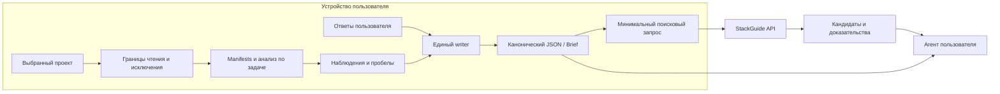

**Данные:** stack, основные компоненты, ограничения, выбранные наблюдения и ссылки на источники. Полный постоянный граф не строится.

**Хранение:** существующее каноническое состояние; промежуточные структуры — временные. При новой задаче выполняется ограниченная проверка нужных источников.

**На веб-сервис:** capabilities, существенные зависимости, ограничения и сокращённые сведения о неполноте анализа.

**Преимущества:** наименьший объём реализации, простая установка, небольшая стоимость обслуживания.

**Недостатки:** больше повторного чтения между задачами; слабее поддержка сложных monorepo и вопросов о связях компонентов.

От Context7 здесь используем небольшой набор операций и поддержку CLI/MCP. От Product-Agent-OS — происхождение наблюдений и короткий диалог.

**Вариант 2 — постоянный локальный движок знаний. Это мой основной выбор.**

Он добавляет инкрементальную базу наблюдений, типизированные связи и карточки компонентов.

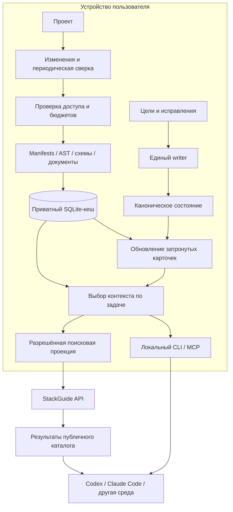

**Данные:** всё из первого варианта плюс выбранные символы, связи компонентов, контракты, карточки capabilities и история актуальности наблюдений.

**Хранение:** приватный SQLite-кеш вне репозитория; решения — в каноническом состоянии; исходники — на прежнем месте.

**На веб-сервис:** такая же минимальная поисковая проекция, как в первом варианте. Подробный граф и внутренние имена остаются локальными.

**LLM используется** для объяснения назначения компонента, сопоставления противоречивых свидетельств и формулировки рекомендаций. Parsing manifests, извлечение структурных связей и определение изменившихся файлов выполняются обычным кодом.

Для локального поиска я бы начал с точных фильтров, полнотекстового поиска и обхода ограниченного числа связанных узлов. Embeddings добавлял бы после проверки, что семантический поиск действительно улучшает подбор контекста.

**Преимущества:** стабильное повторное использование фактов, меньше повторного чтения, независимость знаний от истории конкретного чата, хорошая основа для смены агента.

**Недостатки:** сложнее обновление и восстановление кеша; нужны проверки разных ОС, языков и одновременной работы нескольких клиентов.

Здесь особенно полезны Qoder Knowledge Cards и структурные наблюдения Product-Agent-OS. Защищённые пользовательские правки сохраняем отдельно, а ограничения и source references включаем в каждый пакет контекста.

**Вариант 3 — локальный scanner и приватная командная база знаний в облаке.**

Этот вариант рассчитан на несколько участников, разные устройства и постоянную работу через веб-сайт. По умолчанию синхронизируются согласованные производные знания, без полной загрузки репозитория.

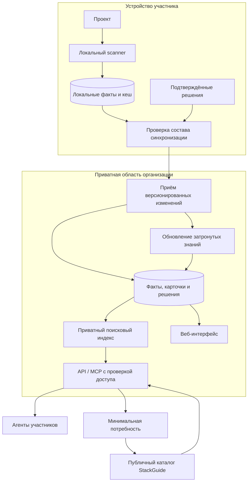

**Данные в облаке:** разрешённые карточки, технический профиль, выбранные отношения компонентов, командные решения и сведения об актуальности. Даже без исходников это конфиденциальные сведения.

**Хранение:** отдельная приватная область организации. Для рассматриваемого Cloudflare stack возможна такая схема:

- Workers — API и проверка доступа;
- D1 — структурированные записи и версии;
- R2 — более крупные версии карточек и экспортов;
- Vectorize — при необходимости семантический индекс разрешённых карточек;
- Queues — обновление знаний после изменений.

Это предлагаемое распределение компонентов, не проверенная конфигурация нагрузки.

Публичный каталог и приватные знания команды должны иметь раздельные потоки обработки. Одного префикса в идентификаторе вектора недостаточно: доступ проверяется при каждом запросе и получении объекта.

**Jev и другие облачные модели** здесь можно исследовать для классификации и обработки изменившихся карточек. Их входные данные будут частью разрешённой облачной обработки. Удаление исходников после вычисления embeddings не делает оставшиеся векторы или карточки публичными данными.

**Преимущества:** общая память команды, веб-доступ, повторное использование знаний между устройствами, возможность платных командных функций.

**Недостатки:** выше стоимость разработки и эксплуатации; требуется разрешение конфликтов между участниками, управление доступом и удаление данных из зависимых индексов и кешей.

Этот вариант потребует нового контракта передачи приватных данных. Текущая локальная архитектура такую синхронизацию не включает.

**Выбор между вариантами зависит прежде всего от того, кому принадлежат знания и сколько раз они будут переиспользоваться.**

| Критерий | 1. Лёгкий паспорт | 2. Локальный движок | 3. Командное облако |
|---|---|---|---|
| Скорость первого выпуска | Наибольшая | Средняя | Наименьшая |
| Повторное использование контекста | Ограниченное | Высокое на устройстве | Высокое между участниками |
| Объём данных в нашем облаке | Минимальный запрос | Минимальный запрос | Разрешённые знания проекта |
| Поддержка сложного проекта | Ограниченная | Основной сценарий | Основной сценарий с командной работой |
| Наши постоянные расходы | Низкие | Низкие или умеренные | Выше: хранение, синхронизация, обработка |
| Удобство смены агента | Через общий формат паспорта | Через общий локальный API | Через общий API и права команды |

Есть ещё одна общая граница: **локальное расположение scanner не означает локальное выполнение модели**. Если агент пользователя работает через облачную LLM, выбранный им контекст может передаваться её провайдеру. Наше обещание должно точно описывать, что получает StackGuide и что получает используемый пользователем агент.

**Для нас рационален путь от первого варианта ко второму, с возможностью позже добавить третий.**

Первый проверяемый результат я бы ограничил следующим:

1. Общая схема наблюдений с источником, fingerprint и версией extractor.
2. Извлечение manifests, workspace boundaries и одного востребованного типа интерфейсов.
3. Локальный кеш и корректное обновление после изменения, удаления и добавления файла.
4. Карточка одного компонента с фактами, предположениями и неизвестными.
5. Выдача одинакового пакета через CLI и MCP.
6. Проверка, что смена агента сохраняет знания и решения пользователя.

Ключевые проверки — совпадение инкрементального результата с чистым анализом при одинаковом охвате; отсутствие устаревших фактов после удаления файлов; сохранение пользовательских исправлений; контроль передаваемых данных; уменьшение чтения и модельного контекста без потери полезности.

При сверке текущих документов обнаружилось расхождение: team contract ещё упоминает checkpoint в 2 MiB, тогда как owning contract, схема и scanner задают 64 MiB. Перед реализацией нового хранения это стоит согласовать; в данном исследовании документы не изменялись. [Team contract](C:/Users/user/Desktop/project/github_research/agentic-engineering-catalog/docs/plan/plugin-v1-team-contracts.md:47), [owning contract](C:/Users/user/Desktop/project/github_research/agentic-engineering-catalog/specs/artifact/session-workspace-contract.md:7), [scanner](C:/Users/user/Desktop/project/github_research/agentic-engineering-catalog/plugins/myai-stackguide/scripts/scanner.py:41).

Изменён только архив ответов. Исследование опирается на документацию и исходники; scanner на новых проектах, модельные вызовы и нагрузочные измерения в этой работе не запускались.

<oai-mem-citation>
<citation_entries>
MEMORY.md:24-28|note=[Prior architecture boundaries and incremental context proposal used for continuity]
MEMORY.md:33-34|note=[Proposal evidence ceiling and separation from existing lifecycle work]
</citation_entries>
<rollout_ids>
01a15a47-7095-7433-a071-0f3f6970fc4d
</rollout_ids>
</oai-mem-citation>